# AICore — AI Computer Control Layer

## AI 原生计算机智能控制层项目计划书

---

# 1. 项目总目标

## 1.1 项目愿景

AICore 的目标不是开发一个传统的“电脑优化工具”，也不是简单地在电脑上增加一个 AI 助手。

项目目标是建立一个位于：

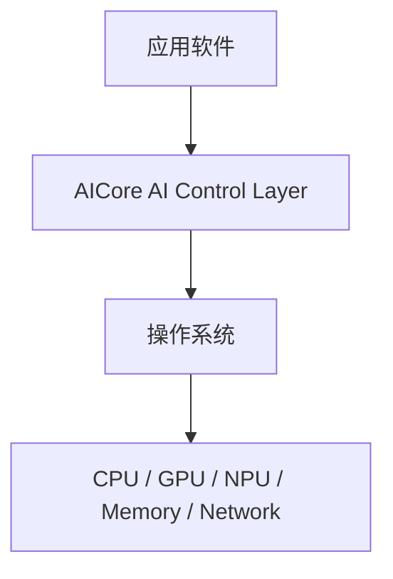

之间的、**跨操作系统、跨硬件、可扩展、可维护、接口解耦的 AI 控制层**。

AICore 负责理解：

```text
用户意图
应用状态
任务类型
系统状态
硬件状态
历史运行数据
AI 工作负载
功耗与温度
```

然后生成：

```text
资源策略
任务优先级
执行设备
后台任务策略
功耗策略
AI workload 策略
```

最终实现：

> **让计算机从“被动执行软件”逐渐转变为“能够理解上下文并主动协调自身资源”的智能计算系统。**

---

### 项目定位

AICore 定位为：

> **面向 Windows / Linux 的 AI 原生计算机智能控制层（AI Computer Control Layer）。**

它位于应用软件、操作系统与计算硬件之间，通过统一接口理解应用任务、用户意图与系统状态，并通过可扩展的策略与执行机制协调 CPU、GPU、NPU、内存、功耗以及后台任务。

## 1.2 产品总目标

AICore 最终需要实现以下能力：

### 目标 A：系统感知

持续获取：

```text
CPU
GPU
NPU
RAM
Storage
Network
Temperature
Power
Process
Application
Foreground Task
System Load
```

形成统一的：

```text
Computer State
```

---

### 目标 B：任务理解

识别当前计算任务，例如：

```text
Gaming
Coding
Video Editing
AI Inference
Rendering
Compilation
File Processing
Background Task
Video Conference
General Office
```

并进一步识别：

```text
Interactive
Latency Sensitive
Throughput Sensitive
Energy Sensitive
Background
Deadline Sensitive
Privacy Sensitive
```

---

### 目标 C：AI 决策

根据：

```text
Computer State
+
User Context
+
Task Context
+
Historical Data
```

形成：

```text
Resource Policy
```

例如：

```text
Task A → NPU
Task B → GPU
Task C → CPU
Task D → Background
Task E → Deferred
```

---

### 目标 D：资源协调

统一管理：

```text
CPU scheduling
GPU workload
NPU workload
Memory pressure
Process priority
Power policy
Background workload
AI model execution
```

第一阶段通过用户态 API 实现。

后续根据操作系统能力逐步增加低层控制。

---

### 目标 E：跨平台

首期：

```text
Windows
Linux
```

暂不开发：

```text
macOS
```

目标不是对每个操作系统写一套完整产品，而是：

> **核心业务逻辑完全与操作系统解耦。**

平台差异全部收敛到 Adapter 层。

---

### 目标 F：长期可扩展

未来可以增加：

```text
NVIDIA
AMD
Intel
Qualcomm
Apple
新的 NPU
新的 OS
新的 AI Runtime
新的控制接口
新的 Agent
```

而不修改核心调度系统。

---

# 2. 设计理念与设计哲学

## 2.1 核心设计理念

AICore 遵循：

> **AI 决策、OS 执行、硬件完成。**

AI 不应该直接控制底层硬件。

正确关系：

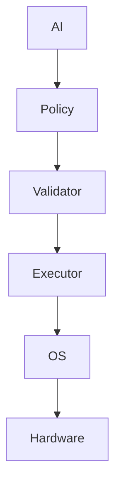

而不是：

```text
LLM
 ↓
Kernel
```

---

## 2.2 设计哲学一：高内聚、低耦合

每一个模块只负责一个清晰的职责。

例如：

```text
Telemetry
只负责采集数据

Context
只负责构建上下文

Policy
只负责产生策略

Validator
只负责验证策略

Executor
只负责执行

Adapter
只负责平台适配

Memory
只负责历史记录
```

禁止：

```text
Telemetry → 直接修改 CPU
AI → 直接调用 Windows API
Windows Adapter → 直接访问数据库
Policy → 直接访问硬件
UI → 直接访问 Kernel
```

---

## 2.3 设计哲学二：依赖抽象，不依赖实现

核心模块永远依赖：

```text
Interface
Contract
Protocol
DTO
Domain Model
```

而不是：

```text
WindowsAdapter
LinuxAdapter
NvidiaAdapter
AMDAdapter
```

例如：

```text
IResourceController
```

核心只知道：

```text
allocate()
release()
setPriority()
setPolicy()
```

至于：

```text
Windows 怎么实现
Linux 怎么实现
```

核心完全不知道。

---

## 2.4 设计哲学三：黑盒化

每个模块内部实现都视为黑盒。

模块只暴露：

```text
Public Interface
```

例如：

```text
TelemetryModule
 ├── collect()
 ├── subscribe()
 └── getSnapshot()
```

内部可能是：

```text
WMI
ETW
procfs
sysfs
DXGI
NVML
ROCm
Windows ML
ONNX Runtime
```

但是这些细节不能泄漏到上层。

---

## 2.5 设计哲学四：接口优先

所有模块先定义接口：

```text
interface
↓
contract
↓
implementation
```

而不是：

```text
先写代码
↓
后面再考虑接口
```

项目中所有跨模块通信必须经过明确接口。

---

## 2.6 设计哲学五：AI不是唯一决策者

AICore 不允许：

```text
LLM → 直接执行
```

采用：

```text
AI Recommendation
        ↓
Policy Engine
        ↓
Rule / Constraint
        ↓
Validator
        ↓
Executor
```

AI 可以提出策略，但系统负责最终验证。

---

## 2.7 设计哲学六：慢 AI + 快控制

系统采用双层控制回路。

### Fast Loop

```text
10ms ~ 100ms
```

负责：

```text
执行
状态更新
资源控制
安全检查
```

必须：

```text
Deterministic
Low Latency
Stable
```

---

### Slow Intelligent Loop

```text
100ms ~ seconds
```

负责：

```text
预测
任务分类
策略生成
用户意图理解
历史分析
AI 推理
```

结构：

```text
               AI Brain
                  │
        ┌─────────┴─────────┐
        ↓                   ↓
    Slow Loop            Fast Loop
  Prediction/Policy      Execution
        │                   │
        └─────────┬─────────┘
                  ↓
              Hardware
```

---

# 3. 产品总体架构

AICore 采用：

> **Control Plane + Data Plane + Adapter Plane**

三层架构。

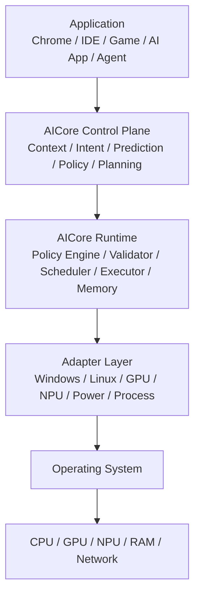

---

# 4. 数据流向

AICore 使用闭环数据流。

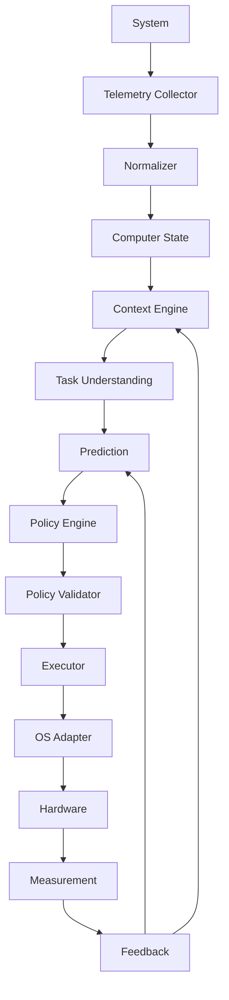

完整闭环：

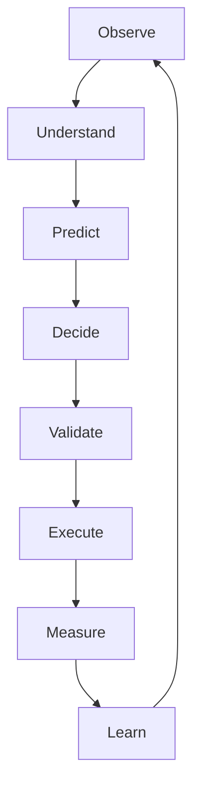

---

# 5. 项目实施阶段

项目分为 8 个主要阶段。

---

## Phase 0：产品定义与基础架构

### 工作内容

| 工作内容 |
|---|
| 产品需求 |
| 架构规范 |
| 接口规范 |
| 代码规范 |
| 测试规范 |
| 文档规范 |
| 版本规范 |

### 完成项

| 完成项 |
|---|
| Architecture Document |
| API Contract |
| Module Specification |
| Coding Standard |
| Testing Strategy |
| Compatibility Matrix |

### 阶段目标

得到一个可以持续开发的基础工程，而不是快速堆代码。

### 交付物

| 交付物 |
|---|
| `docs/` |
| `README.md` |
| `ARCHITECTURE.md` |
| `API_SPEC.md` |
| `CODING_STANDARD.md` |
| `TESTING.md` |
| `COMPATIBILITY.md` |

---

## Phase 1：Computer Observer

这一阶段：

> **只观察，不控制。**

### 实现

| 采集项 |
|---|
| CPU |
| GPU |
| NPU |
| RAM |
| Disk |
| Network |
| Temperature |
| Battery |
| Power |
| Process |
| Application |

形成：

```text
ComputerSnapshot
```

示例：

```json
{
  "cpu": {
    "usage": 63,
    "temperature": 68
  },
  "gpu": {
    "usage": 31
  },
  "npu": {
    "usage": 74
  },
  "memory": {
    "usage": 71
  }
}
```

### 阶段目标

建立：

> **统一跨平台计算机状态模型。**

Windows 与 Linux 无论底层采用什么 API，都转换为同一个标准结构。

---

## Phase 2：Context Engine

目标：

> 让电脑知道“现在发生了什么”。

识别：

| 识别项 |
|---|
| Current App |
| Foreground App |
| Active Window |
| Current Process |
| User Activity |
| Workload Type |
| Interaction Level |

例如：

```text
VS Code
+
Terminal
+
Browser
+
Local LLM
```

识别为：

```text
Development + AI Workload
```

---

## Phase 3：Policy Engine

这一阶段开始建立真正的 AI Control。

输入：

```text
ComputerState
Context
Task
UserPreference
```

输出：

```text
ResourcePolicy
```

例如：

```json
{
  "priority": "interactive",
  "cpu": {
    "priority": "high"
  },
  "gpu": {
    "priority": "high"
  },
  "npu": {
    "priority": "normal"
  },
  "background": {
    "throttle": true
  }
}
```

---

## Phase 4：Executor

目标：

> 让策略真正执行。

建立：

| 接口 |
|---|
| `IProcessController` |
| `IResourceController` |
| `IPowerController` |
| `IGpuController` |
| `INpuController` |

Windows：

| Adapter |
|---|
| `WindowsProcessAdapter` |
| `WindowsPowerAdapter` |
| `WindowsGpuAdapter` |
| `WindowsNpuAdapter` |

Linux：

| Adapter |
|---|
| `LinuxProcessAdapter` |
| `LinuxPowerAdapter` |
| `LinuxGpuAdapter` |
| `LinuxNpuAdapter` |

核心代码不允许出现：

```text
if Windows
if Linux
```

这种平台判断。

平台判断只能存在 Adapter / Platform 层。

---

## Phase 5：AI Intelligence

这一阶段接入：

| 能力 |
|---|
| Small Language Model |
| Machine Learning |
| Prediction Model |
| Classifier |

AI 主要负责：

| AI 职责 |
|---|
| Task Classification |
| Load Prediction |
| Runtime Prediction |
| Energy Prediction |
| Resource Recommendation |
| User Intent |

不要让 LLM 负责高频调度。

正确结构：

```text
LLM
 ↓
High-level Policy
 ↓
Deterministic Policy Engine
 ↓
Executor
```

---

## Phase 6：Personalization

开始引入长期数据：

| 数据 |
|---|
| Historical Workload |
| User Preferences |
| Application Patterns |
| Performance History |
| Power Usage History |

建立：

```text
Personal Computer Model
```

例如：

```text
用户通常：
09:00 Coding
12:00 Browser
18:00 Gaming
21:00 Local AI
```

系统逐渐形成：

```text
Predictive Scheduling
```

而不是始终被动响应。

---

## Phase 7：Application Integration

这一阶段建立应用与 AICore 的正式接口。

应用可以声明：

| 声明项 |
|---|
| Task Type |
| Latency Sensitivity |
| GPU Requirement |
| NPU Requirement |
| Power Preference |
| Privacy Requirement |
| Deadline |

例如：

```json
{
  "task": "llm_inference",
  "latency": "high",
  "power": "balanced",
  "privacy": "local_only"
}
```

AICore 不需要知道：

```text
Chrome
VS Code
Blender
Game
```

的内部实现。

应用只需要遵守：

```text
AICore Task Contract
```

---

## Phase 8：Adaptive AI Computer

最终形成：

```text
Application
      ↓
Task Contract
      ↓
AICore
      ↓
User Intent
+
System State
+
Historical Data
+
AI Prediction
      ↓
Global Policy
      ↓
CPU / GPU / NPU / Memory / Power
```

系统具有：

```text
Observe
Predict
Adapt
Optimize
Learn
```

的闭环能力。

---

# 6. 项目代码框架

推荐采用：

```text
AICore/
│
├── apps/
│   ├── desktop/
│   ├── dashboard/
│   └── cli/
│
├── core/
│   ├── domain/
│   ├── context/
│   ├── policy/
│   ├── scheduler/
│   ├── prediction/
│   └── orchestration/
│
├── contracts/
│   ├── telemetry/
│   ├── tasks/
│   ├── policy/
│   ├── resources/
│   └── events/
│
├── runtime/
│   ├── engine/
│   ├── executor/
│   ├── validator/
│   ├── registry/
│   └── lifecycle/
│
├── adapters/
│   ├── os/
│   │   ├── windows/
│   │   └── linux/
│   │
│   ├── hardware/
│   │   ├── cpu/
│   │   ├── gpu/
│   │   └── npu/
│   │
│   └── power/
│
├── ai/
│   ├── models/
│   ├── inference/
│   ├── classifier/
│   ├── predictor/
│   └── planner/
│
├── memory/
│   ├── storage/
│   ├── history/
│   └── profile/
│
├── api/
│   ├── public/
│   ├── internal/
│   └── schemas/
│
├── plugins/
│
├── tests/
│   ├── context.buildState.unit.test.rs
│   ├── policy.generatePolicy.unit.test.rs
│   ├── prediction.predictLoad.unit.test.rs
│   ├── validator.validatePolicy.unit.test.rs
│   ├── scheduler.scheduleTask.unit.test.rs
│   ├── memory.storeHistory.unit.test.rs
│   ├── process.controller.contract.test.rs
│   ├── adapter.windows.contract.test.rs
│   ├── adapter.linux.contract.test.rs
│   ├── pipeline.executePolicy.integration.test.rs
│   ├── scheduler.measureLatency.performance.test.rs
│   ├── system.startup.e2e.test.rs
│   └── executor.recoverFailure.failure.test.rs
│
├── docs/
│   ├── architecture/
│   ├── api/
│   ├── modules/
│   ├── decisions/
│   ├── development/
│   ├── testing/
│   └── compatibility/
│
├── scripts/
│
├── configs/
│
└── README.md
```

---

### 测试文件命名规范

| 项目 | 规范 |
|---|---|
| 文件夹结构 | 仅使用 `tests/`，不建立测试子文件夹 |
| 基本格式 | `功能名.功能说明.[功能补充说明].test.后缀名` |
| 驼峰式 | 功能名、功能说明、可选补充说明均采用驼峰式命名 |
| 单词数量 | 尽量控制在五个单词以内 |
| 语言后缀 | 根据实现语言使用 `.rs`、`.ts`、`.js` 等 |

# 7. 模块职责

| 模块 | 职责 | 约束 |
|---|---|---|
| `core` | 只保存 Business Logic、Domain Logic、Policy Logic | 禁止依赖具体 OS |
| `contracts` | 定义 Interfaces、DTO、Events、Commands、Responses | 这是整个项目最重要的“边界” |
| `adapters` | 负责 Windows、Linux、Intel、AMD、NVIDIA、NPU、GPU、Power、Process | 只实现接口 |
| `runtime` | 负责 Lifecycle、Scheduling、Execution、Validation、Plugin Management | — |
| `ai` | 负责 Model、Inference、Prediction、Classification、Planning | AI 模型不是核心业务逻辑；模型可以替换 Model A → Model B → Model C，不应该修改 Core |

---

# 8. 黑盒化设计

每个模块必须遵循：

```text
Private Implementation
        ↓
Public Interface
```

例如：

```text
NPU Module
```

外部只能看到：

```ts
interface INpuController {

    getCapabilities(): Promise<NpuCapabilities>;

    submit(task: NpuTask): Promise<TaskHandle>;

    cancel(handle: TaskHandle): Promise<void>;

    getStatus(): Promise<NpuStatus>;
}
```

内部可以是：

```text
Windows ML
ONNX Runtime
DirectML
AMD Runtime
Intel Runtime
Qualcomm Runtime
```

但这些实现不允许泄漏到 Core。

---

# 9. 接口解耦设计

接口必须做到：

> **可以随时增加、删除、替换实现。**

例如：

```text
IGpuController
```

未来可以拥有：

```text
NvidiaGpuController
AmdGpuController
IntelGpuController
```

Core：

```text
IGpuController
```

永远不需要知道：

```text
Nvidia
AMD
Intel
```

---

# 10. 插件架构

推荐建立：

```text
Plugin Registry
```

例如：

| Plugin 项 |
|---|
| Metadata |
| Capabilities |
| Version |
| Interfaces |
| Lifecycle |

示例：

```json
{
  "name": "amd-gpu-adapter",
  "version": "1.0.0",
  "interfaces": [
    "IGpuController",
    "IGpuTelemetry"
  ]
}
```

加载：

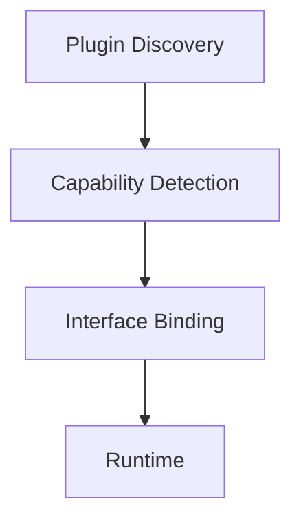

这样增加新硬件时不需要修改核心代码。

---

# 11. API 设计原则

API 必须：

| 原则 | 要求 |
|---|---|
| 稳定 | 不因为内部实现改变而改变。 |
| 独立 | API 不暴露 Windows API、Linux API、AMD API、NVIDIA API。 |
| 可版本化 | 使用 `v1`、`v2`、`v3` 或 Semantic Versioning。 |

例如：

```text
ResourceController v1
```

升级后：

```text
ResourceController v2
```

旧应用仍然可以使用 v1。

---

# 12. 事件系统

模块之间尽量避免直接调用。

例如不要：

```text
Telemetry
 ↓
Policy
 ↓
Executor
```

全部强依赖。

可以增加：

```text
Event Bus
```

例如：

| 事件 |
|---|
| `SystemStateUpdated` |
| `TaskStarted` |
| `TaskFinished` |
| `ResourceChanged` |
| `UserContextChanged` |
| `PolicyUpdated` |
| `ExecutionCompleted` |

这样：

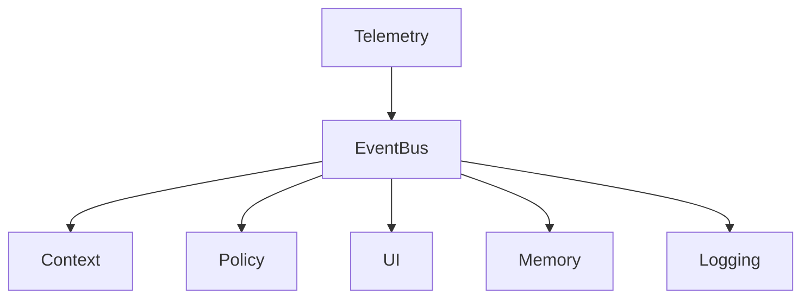

彼此保持低耦合。

---

# 13. 数据层设计

数据分成四类。

| 数据类型 | 数据 | 存储策略 |
|---|---|---|
| Realtime State | CPU、GPU、NPU、RAM、Temperature、Power | 不长期保存 |
| Historical Data | Task、Runtime、Energy、Resource usage、Policy result | 长期保存 |
| User Profile | Preferences、Work habits、Power preference、Privacy preference | — |
| AI Memory | Prediction、Decision、Decision Result、Policy Effectiveness | — |

---

# 14. 测试体系

项目必须把测试当成正式代码，而不是最后补测试。

测试目录采用**扁平化设计**：只有 `tests/` 文件夹，不再建立 `unit/`、`contract/`、`integration/` 等子文件夹。

测试文件统一采用：

```text
功能名.功能说明.[功能补充说明].test.后缀名
```

其中：

| 命名项 | 规则 |
|---|---|
| 功能名 | 驼峰式命名 |
| 功能说明 | 驼峰式命名 |
| 功能补充说明 | 可选，驼峰式命名 |
| `test` | 固定 |
| 后缀名 | 根据实现语言使用 `.rs`、`.ts`、`.js` 等 |

示例：

| 测试类型 | 文件名示例 |
|---|---|
| Unit Test | `context.buildState.unit.test.rs` |
| Unit Test | `policy.generatePolicy.unit.test.rs` |
| Unit Test | `prediction.predictLoad.unit.test.rs` |
| Unit Test | `validator.validatePolicy.unit.test.rs` |
| Unit Test | `scheduler.scheduleTask.unit.test.rs` |
| Unit Test | `memory.storeHistory.unit.test.rs` |
| Contract Test | `process.controller.contract.test.rs` |
| Contract Test | `adapter.windows.contract.test.rs` |
| Contract Test | `adapter.linux.contract.test.rs` |
| Integration Test | `pipeline.executePolicy.integration.test.rs` |
| Performance Test | `scheduler.measureLatency.performance.test.rs` |
| End-to-End Test | `system.startup.e2e.test.rs` |
| Failure Test | `executor.recoverFailure.failure.test.rs` |

### Unit Test

测试：

| 测试项 |
|---|
| Context |
| Policy |
| Prediction |
| Validator |
| Scheduler |
| Memory |

---

### Contract Test

确保接口没有被破坏。

例如：

| Adapter |
|---|
| WindowsAdapter |
| LinuxAdapter |

必须通过完全相同的：

```text
IProcessController Contract
```

测试。

---

### Adapter Test

分别测试：

| Adapter |
|---|
| Windows |
| Linux |
| AMD |
| Intel |
| NVIDIA |

---

### Integration Test

测试：

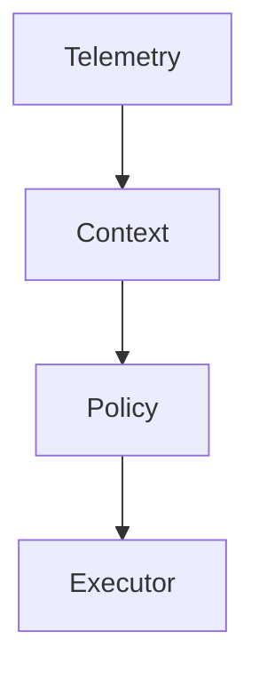

整条链。

---

### Performance Test

必须测：

| 指标 |
|---|
| CPU overhead |
| Memory overhead |
| AI inference overhead |
| Scheduling latency |
| Decision latency |
| Policy execution latency |

---

### End-to-End Test

例如：

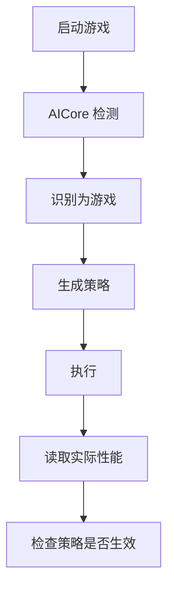

---

### Failure Test

故意制造：

| 故障 |
|---|
| AI 模型崩溃 |
| Adapter 崩溃 |
| NPU 不可用 |
| GPU 不可用 |
| 权限不足 |
| 系统 API 不存在 |
| 策略非法 |
| 硬件突然断开 |

系统必须：

```text
Fail Safe
```

而不是：

```text
AI 崩溃
→
电脑崩溃
```

---

# 15. 文档体系

项目文档必须与代码一起开发。

```text
docs/
│
├── architecture/
│   ├── overview.md
│   ├── control-plane.md
│   ├── data-plane.md
│   └── adapter-architecture.md
│
├── api/
│   ├── public-api.md
│   ├── task-contract.md
│   ├── policy-contract.md
│   └── plugin-api.md
│
├── modules/
│   ├── telemetry.md
│   ├── context.md
│   ├── policy.md
│   ├── executor.md
│   └── memory.md
│
├── development/
│   ├── setup.md
│   ├── coding-style.md
│   ├── contribution.md
│   └── build.md
│
├── testing/
│   ├── strategy.md
│   ├── benchmarks.md
│   └── compatibility.md
│
├── decisions/
│   ├── ADR-001-core-architecture.md
│   ├── ADR-002-plugin-system.md
│   ├── ADR-003-ai-control-loop.md
│   └── ADR-004-cross-platform.md
│
└── compatibility/
    ├── windows.md
    └── linux.md
```

---

# 16. 软件开发基本原则

整个项目必须遵守：

| 原则 | 要求 |
|---|---|
| Single Responsibility | 每个模块只负责单一职责。 |
| Open/Closed | 新增 GPU、NPU、OS、Model 时优先 Add，而不是 Modify Core。 |
| Liskov Substitution | 接口实现可以互换而不破坏核心行为。 |
| Interface Segregation | 按职责拆分接口，避免不必要的依赖。 |
| Dependency Inversion | Core 依赖接口，而不是依赖 Windows / Linux。 |
| 高内聚 | 每个模块内部功能高度相关；例如 `PolicyEngine` 只负责 Policy。 |
| 低耦合 | 模块之间通过 Interface、Event、Contract、DTO 交流。 |

---

# 17. 跨平台架构

统一：

```text
AICore Core
```

平台差异：

```text
Platform Adapter
```

例如：

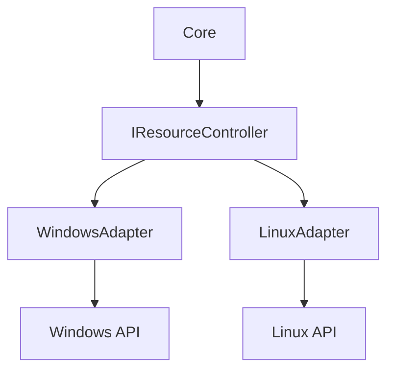

同样：

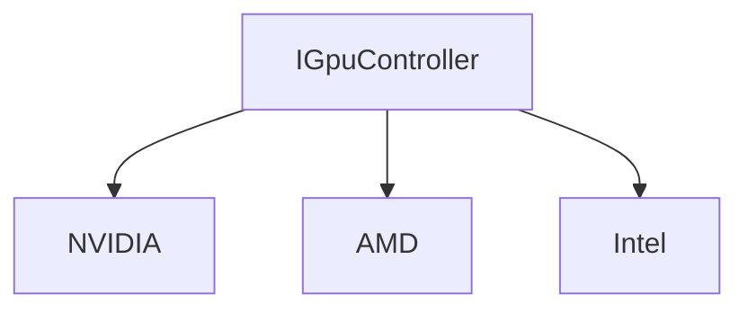

核心代码永远不知道具体实现。

---

# 18. 推荐技术栈

| 层 | 技术 | 说明 |
|---|---|---|
| Core | Rust | 优先考虑。性能、安全、跨平台、低内存占用、适合系统级常驻服务。 |
| Core（原型） | C++ | 也可以在原型阶段使用。长期建议使用 Rust 或 Rust + C/C++ Adapter。 |
| AI | ONNX Runtime、llama.cpp、ONNX、Windows ML、Vendor Runtime | 模型可以替换，核心不绑定某个模型。 |
| API | IPC、gRPC、Unix Domain Socket、Named Pipe | Windows 使用 Named Pipe / Local IPC；Linux 使用 Unix Domain Socket。 |
| UI | Web UI、Electron、Tauri | 如果核心采用 Rust，更推荐 Tauri，这样常驻服务与 UI 分离。 |

---

# 19. 产品运行结构

最终建议：

```text
AICore
│
├── aicored
│   └── Core Service
│
├── aicore-agent
│   └── AI / Prediction
│
├── aicore-adapter
│   ├── Windows
│   └── Linux
│
├── aicore-cli
│
└── aicore-ui
```

其中：

```text
aicored
```

永远运行。

UI：

```text
可开可不开
```

即使 UI 被关闭：

> AICore 仍然正常运行。

---

# 20. 产品运行时数据流

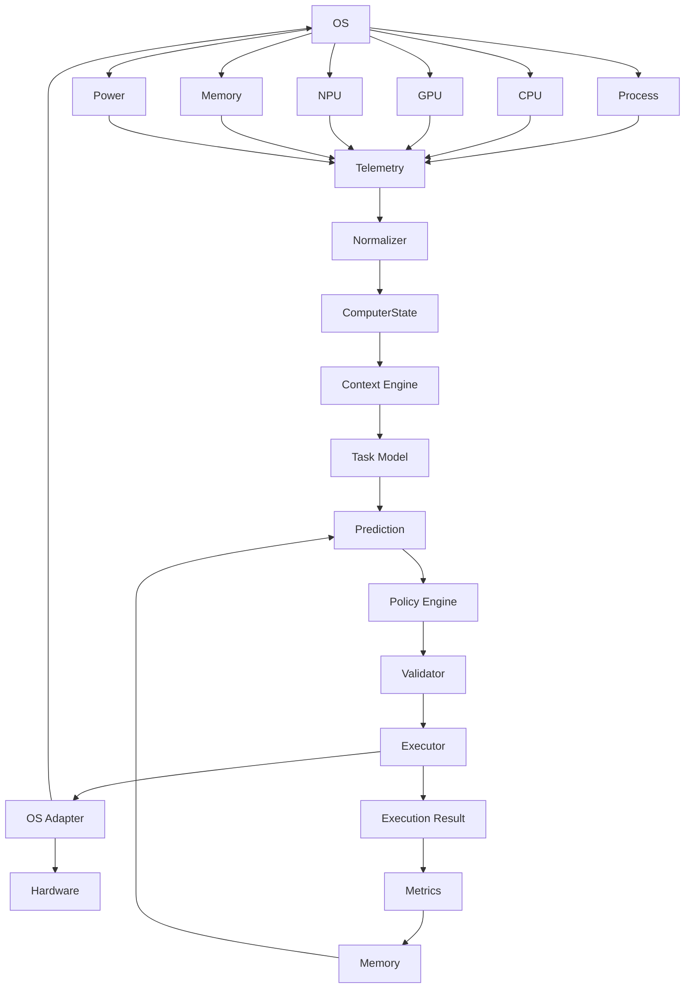

形成闭环。

---

# 21. 安全原则

AICore 是系统级产品，因此必须遵守：

> AI 永远不能拥有无限制的系统控制权。

所有操作必须经过：

```text
Permission
Capability
Validation
Policy
```

例如：

```text
AI：
Terminate process X

Validator：
是否允许？

Security Policy：
否

Executor：
拒绝
```

同时所有执行记录：

```text
Decision
Reason
Policy
Result
```

必须可追踪。

---

# 22. 可观测性

产品必须记录：

```text
AI Decision
Policy
Execution
Latency
Resource Effect
Failure
```

例如：

```text
10:00:01
Task detected: Coding

10:00:01
Policy:
CPU = High
NPU = Normal
Background = Low

10:00:02
Execution successful

10:00:05
CPU latency improved 12%
```

这样以后才能知道：

> AI 到底有没有真正优化系统。

---

# 23. 产品核心指标

不能只看：

```text
AI 模型准确率
```

应该看：

### 用户体验

```text
Latency
Responsiveness
Startup Time
Task Completion Time
```

### 系统

```text
CPU overhead
Memory overhead
Energy consumption
Temperature
```

### AI

```text
Prediction Accuracy
Policy Accuracy
Decision Latency
Inference Cost
```

### 稳定性

```text
Crash Rate
Recovery Rate
Adapter Failure Rate
Policy Rejection Rate
```

---

# 24. 第一版 MVP

第一版本不要试图做完整 AI Computer。

建议只完成：

```text
Windows
+
Linux
+
CPU
+
GPU
+
NPU（能获取则获取）
+
Process
+
Memory
+
Power
```

实现：

```text
1. System Observer

2. Workload Classifier

3. Policy Engine

4. Resource Executor

5. Basic AI Prediction

6. Dashboard

7. Logs

8. Testing Framework

9. Plugin System
```

第一版暂时不做：

```text
Kernel scheduler
Advanced agent
Deep personal model
自动修改所有系统参数
复杂长期学习
Mac
```

---

# 25. MVP 产品效果

用户看到的是：

```text
AICore

System
CPU       31%
GPU       18%
NPU       0%
RAM       62%

Current Task
Development

AI Decision
CPU        HIGH
GPU        NORMAL
NPU        AVAILABLE
Background LOW

Reason
Interactive development workload detected.
```

而不是一堆技术参数。

---

# 26. V2

增加：

```text
LLM Agent
Personal Memory
Application Integration
Predictive Scheduling
Cross-device model support
```

系统开始：

> 预测用户下一步会干什么。

---

# 27. V3

增加：

```text
Deep OS Integration
Advanced GPU/NPU scheduling
Kernel integration where justified
Thermal management
Power optimization
AI Agent orchestration
```

最终变成：

```text
AI-native Computer Control Layer
```

---

# 28. 最终产品架构目标

最终：

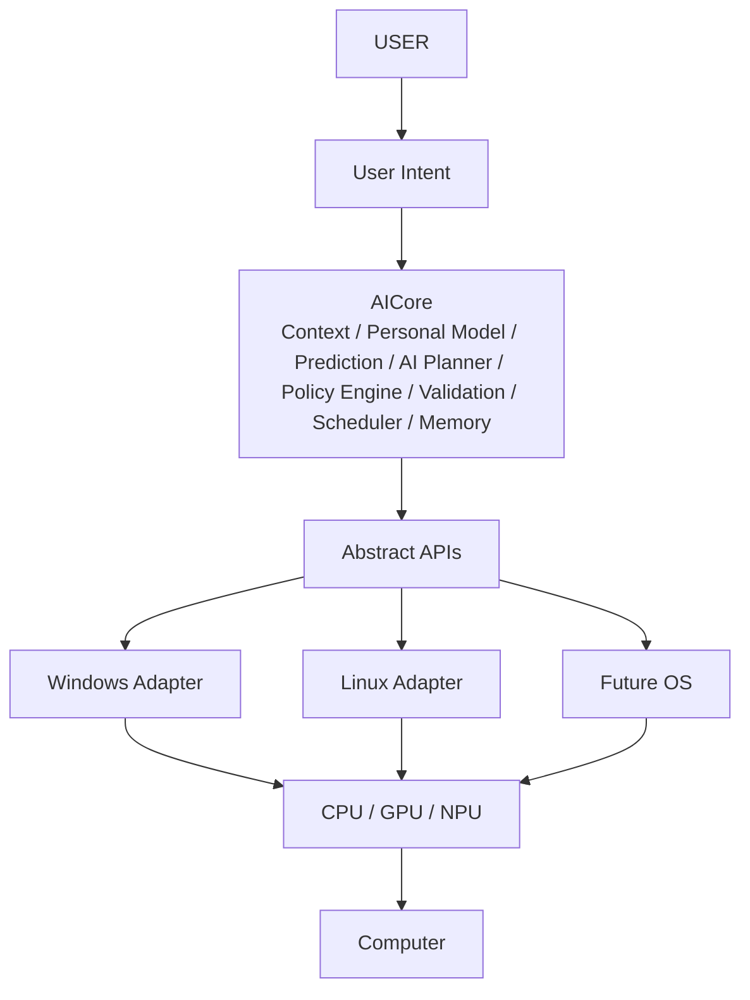

---

# 29. 项目成功标准

AICore 不以：

> “AI 模型多大”

或者：

> “代码多少”

作为成功标准。

而是：

| 标准 | 要求 |
|---|---|
| 第一标准 | 用户不需要手动设置复杂性能参数。 |
| 第二标准 | 系统能够识别当前任务。 |
| 第三标准 | 系统可以自动产生合理的资源策略。 |
| 第四标准 | 策略真正能影响 Performance、Latency、Energy、Responsiveness。 |
| 第五标准 | 更换 OS、Hardware、AI Model、Adapter 不会大规模修改 Core。 |
| 第六标准 | 所有模块都有 Interface、Test、Documentation。 |
| 第七标准 | 出现异常时，AI 可以失败，但操作系统不能因为 AI 失败而失败。 |

---

# 30. 项目最终定位

AICore 最终不是：

> AI Assistant

也不是：

> PC Optimizer

而是：

## **AI Computer Control Layer**

即：

> **一个连接用户、应用、操作系统与计算硬件的智能控制层。**

其最终目标是：

```text
Software
     ↓
Intent
     ↓
AI Understanding
     ↓
System Policy
     ↓
Resource Orchestration
     ↓
Hardware
```

从而让计算机从：

> **Software-defined Computer**

逐渐演变为：

> **AI-managed Computer**

---

# 31. 推荐项目开发顺序

实际开发严格遵循：

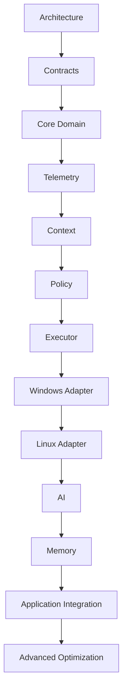

而不是：

```text
先做 UI
↓
再拼 AI
↓
最后补系统功能
```

---

# 32. 项目最重要的工程规则

整个项目长期遵循以下规则：

| 编号 | 工程规则 |
|---:|---|
| 1 | Core 不依赖 Platform |
| 2 | Core 不依赖 UI |
| 3 | Core 不依赖具体 AI Model |
| 4 | Core 不依赖具体 Hardware Vendor |
| 5 | Adapter 不包含业务逻辑 |
| 6 | UI 不直接访问 OS |
| 7 | AI 不直接执行系统操作 |
| 8 | 所有系统操作经过 Executor |
| 9 | 所有策略经过 Validator |
| 10 | 所有跨模块通信通过 Interface / Event / Contract |
| 11 | 每一个公共接口必须有测试 |
| 12 | 每一个平台 Adapter 必须有 Contract Test |
| 13 | 每一个重要架构决定必须记录 ADR |
| 14 | 每个模块必须有独立文档 |
| 15 | 任何新功能必须优先考虑是否能作为新模块/插件加入 |

---

# 33. 最终目标

AICore 最终希望形成：

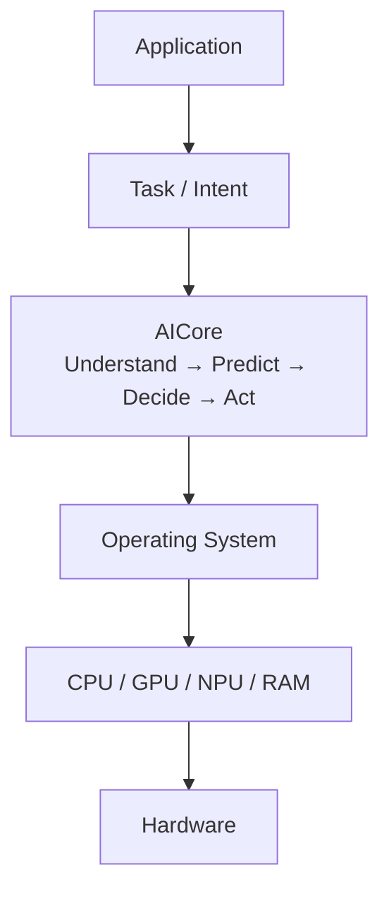

真正做到：

> **应用告诉计算机“我要完成什么”，AI 控制层理解“为什么以及现在应该怎么做”，操作系统负责安全执行，硬件负责真正完成计算。**

最终形成一个高内聚、低耦合、黑盒化、接口化、跨平台、可扩展的 **AI-native Computer Control Layer**。
