[English](destination.md) | [Chinese](destination.zh-CN.md)
# AICore — AI Computer Control Layer

## Project plan for an AI-native computer control layer

---

# 1. Overall objective of the project

## 1.1 Project vision

The goal of AICore is not to develop a traditional "computer optimization tool" or simply to add an AI assistant to the computer.

The project establishes the following architecture:

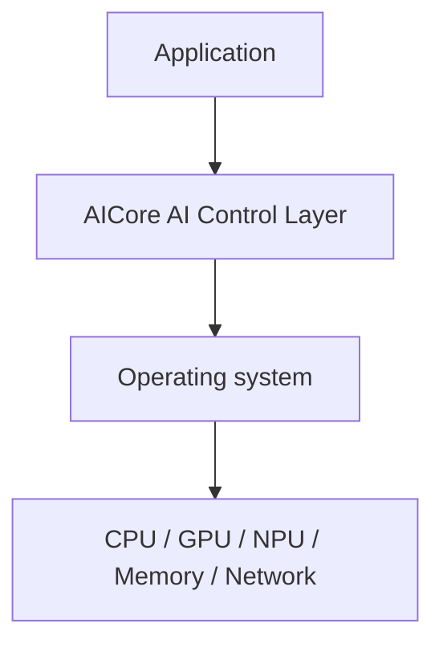

A cross-platform, cross-hardware AI control layer with stable interfaces, scalability, and maintainability.

AICore is responsible for understanding:

```text
User intent
Application state
Task type
System state
Hardware state
Historical runtime data
AI workload
Power consumption and temperature
```

It then produces:

```text
Resource policy
Task priority
Execution device
Background task policy
Power policy
AI workload policy
```

The intended outcome is:

> **Gradually transform computers from passive software executors into intelligent computing systems that understand context and proactively coordinate their own resources.**

---

### Project positioning

AICore is positioned as:

> **An AI Computer Control Layer for Windows and Linux.**

It sits between applications, operating systems, and computing hardware. Through stable interfaces it understands application tasks, user intent, and system state, then coordinates CPU, GPU, NPU, memory, power, and background work through extensible policy and execution mechanisms.

## 1.2 Overall product objective

AICore ultimately requires the following capabilities:

### Target A: System perception

Ongoing acquisition:

```text
CPU
GPU
NPU
RAM
Storage
Network
Temperature
Power
Process
Application
Foreground Task
System Load
```

Form a uniform:

```text
Computer State
```

---

### Objective B: Mission understanding

Identify current computing tasks such as:

```text
Gaming
Coding
Video Editing
AI Inference
Rendering
Compilation
File Processing
Background Task
Video Conference
General Office
```

and further identify:

```text
Interactive
Latency Sensitive
Throughput Sensitive
Energy Sensitive
Background
Deadline Sensitive
Privacy Sensitive
```

---

### Target C: AI Decision-making

According to:

```text
Computer State
+
User Context
+
Task Context
+
Historical Data
```

Formation:

```text
Resource Policy
```

For example:

```text
Task A → NPU
Task B → GPU
Task C → CPU
Task D → Background
Task E → Deferred
```

---

### Objective D: Coordination of resources

Unified management:

```text
CPU scheduling
GPU workload
NPU workload
Memory pressure
Process priority
Power policy
Background workload
AI model execution
```

The first stage uses operating-system user-space APIs.

Follow-up, lower-level controls are gradually increased based on operating system capabilities.

---

### Objective E: Cross-platform

First issue:

```text
Windows
Linux
```

Not developed:

```text
macOS
```

The goal is not to write a complete set of products for each operating system, but to:

> ** Core business logic fully deconciliated with operating systems.**

Platform differences are reduced to Adapter.

---

### Objective F: Long-term scalability

The following could be added in the future:

```text
NVIDIA
AMD
Intel
Qualcomm
Apple
New NPU
New OS
New AI runtime
New control interface
New agent
```

Instead of modifying the core movement system.

---

# 2. Design philosophy and design philosophy

## 2.1 Core design concepts

AICore follows:

> ** AI decision-making, OS implementation, hardware completion.**

AI should not directly control the bottom hardware.

Correct relationship:

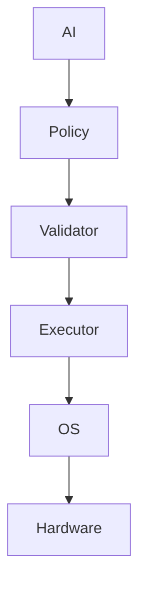

Instead of:

```text
LLM
 ↓
Kernel
```

---

## 2.2 Design philosophy I: high-intensity, low-coherence

Each module has only one clear responsibility.

For example:

```text
Telemetry
Only collects data

Context
Only builds context

Policy
Only produces policies

Validator
Only validates policies

Executor
Only executes

Adapter
Only adapts platforms

Memory
Only records history
```

It is prohibited:

```text
Telemetry -> directly modifies CPU
AI -> directly calls Windows API
Windows Adapter -> directly accesses the database
Policy -> directly accesses hardware
UI -> directly accesses the kernel
```

---

## 2.3 Design philosophy II: Depend on abstractions, not implementations

Core modules are always dependent on:

```text
Interface
Contract
Protocol
DTO
Domain Model
```

Instead of:

```text
WindowsAdapter
LinuxAdapter
NvidiaAdapter
AMDAdapter
```

For example:

```text
IResourceController
```

The core only knows:

```text
allocate()
release()
setPriority()
setPolicy()
```

As for:

```text
How Windows implements it
How Linux implements it
```

The core has no idea.

---

## 2.4 Design philosophy III: Black boxing

Implementation within each module is considered a black box.

Module exposure only:

```text
Public Interface
```

For example:

```text
TelemetryModule
 ├── collect()
 ├── subscribe()
 └── getSnapshot()
```

Internal may be:

```text
WMI
ETW
procfs
sysfs
DXGI
NVML
ROCm
Windows ML
ONNX Runtime
```

But these details can't be leaked to the top.

---

## 2.5 Design philosophy IV: Interface priority

All modules define interfaces first:

```text
interface
↓
contract
↓
implementation
```

Instead of:

```text
Write code first
↓
Consider interfaces later
```

All cross-module communications in the project must be clearly interfaced.

---

## 2.6 Design philosophy V: AI is not the only decision maker

AICore does not allow:

```text
LLM -> executes directly
```

Adopt:

```text
AI Recommendation
        ↓
Policy Engine
        ↓
Rule / Constraint
        ↓
Validator
        ↓
Executor
```

AI can propose strategies, but the system is responsible for final validation.

---

## 2.7 Design philosophy VI: Slow AI + fast control

The system uses two control loops.

### Fast Loop

```text
10ms ~ 100ms
```

Responsible for:

```text
Execution
State update
Resource control
Safety check
```

It is necessary to:

```text
Deterministic
Low Latency
Stable
```

---

### Slow Intelligent Loop

```text
100ms ~ seconds
```

Responsible for:

```text
Prediction
Task classification
Policy generation
User intent understanding
Historical analysis
AI inference
```

Structure:

```text
               AI Brain
                  │
        ┌─────────┴─────────┐
        ↓                   ↓
    Slow Loop            Fast Loop
  Prediction/Policy      Execution
        │                   │
        └─────────┬─────────┘
                  ↓
              Hardware
```

---

# 3. Overall product architecture

AICore adopts:

> **Control Plane + Data Plane + Adapter Plane**

Three-tier architecture.

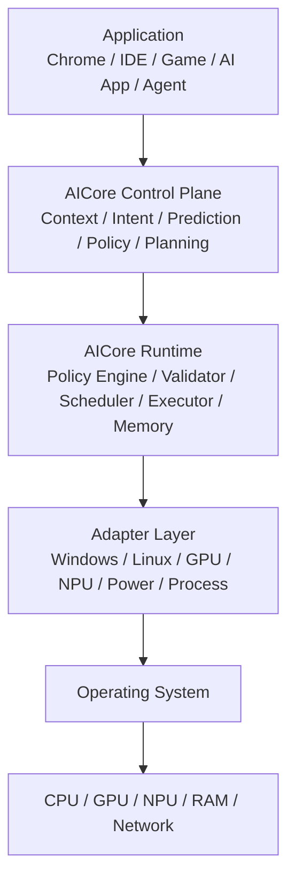

---

# 4. Data flows

AICore uses closed loop data streams.

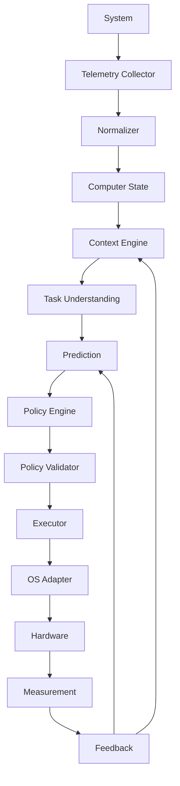

Full closed circle:

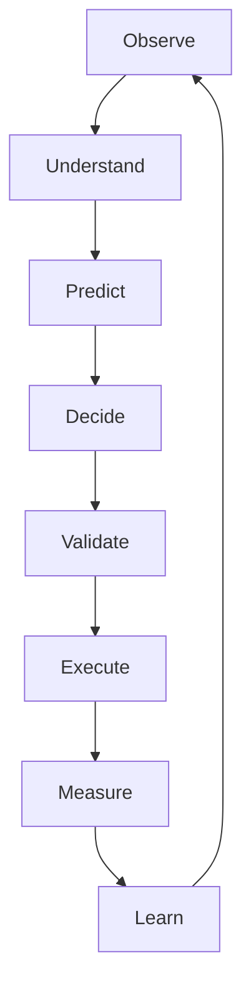

---

# 5. Project implementation phase

The project is divided into eight main phases.

---

## Phase 0: Product definition and infrastructure

### Work

| Work |
|---|
| Product demand |
| Structured norms |
| Interface specification |
| Code Regulation |
| Test Code |
| Document Regulation |
| Version Code |

### Completed Item

| Completed Item |
|---|
| Architecture Document |
| API Contract |
| Module Specification |
| Coding Standard |
| Testing Strategy |
| Compatibility Matrix |

### Phase objectives

Getting a foundationwork that can be developed on a continuous basis instead of fast stacking codes.

### Delivery

| Delivery |
|---|
| `docs/` |
| `README.md` |
| `ARCHITECTURE.md` |
| `API_SPEC.md` |
| `CODING_STANDARD.md` |
| `TESTING.md` |
| `COMPATIBILITY.md` |

---

## Phase 1：Computer Observer

This phase:

> ** Observe only, not control.**

### Deliverables

| Collection |
|---|
| CPU |
| GPU |
| NPU |
| RAM |
| Disk |
| Network |
| Temperature |
| Battery |
| Power |
| Process |
| Application |

Formation:

```text
ComputerSnapshot
```

Example:

```json
{
  "cpu": {
    "usage": 63,
    "temperature": 68
  },
  "gpu": {
    "usage": 31
  },
  "npu": {
    "usage": 74
  },
  "memory": {
    "usage": 71
  }
}
```

### Phase objectives

Create:

> ** Harmonized cross-platform computer status model.**

Windows and Linux are converted to the same standard structure regardless of the bottom API.

---

## Phase 2：Context Engine

Objectives:

> Let the computer know what happened now.

Identification:

| Identification |
|---|
| Current App |
| Foreground App |
| Active Window |
| Current Process |
| User Activity |
| Workload Type |
| Interaction Level |

For example:

```text
VS Code
+
Terminal
+
Browser
+
Local LLM
```

Recognized as:

```text
Development + AI Workload
```

---

## Phase 3：Policy Engine

This phase began to create a real AI control.

Input:

```text
ComputerState
Context
Task
UserPreference
```

Output:

```text
ResourcePolicy
```

For example:

```json
{
  "priority": "interactive",
  "cpu": {
    "priority": "high"
  },
  "gpu": {
    "priority": "high"
  },
  "npu": {
    "priority": "normal"
  },
  "background": {
    "throttle": true
  }
}
```

---

## Phase 4：Executor

Objectives:

> Let the strategy really be implemented.

Create:

| Interface |
|---|
| `IProcessController` |
| `IResourceController` |
| `IPowerController` |
| `IGpuController` |
| `INpuController` |

Windows：

| Adapter |
|---|
| `WindowsProcessAdapter` |
| `WindowsPowerAdapter` |
| `WindowsGpuAdapter` |
| `WindowsNpuAdapter` |

Linux：

| Adapter |
|---|
| `LinuxProcessAdapter` |
| `LinuxPowerAdapter` |
| `LinuxGpuAdapter` |
| `LinuxNpuAdapter` |

Core code is not allowed:

```text
if Windows
if Linux
```

This platform judgement.

The platform determines that only Adapter/ Platform layer exists.

---

## Phase 5：AI Intelligence

This phase of access:

| Capacity |
|---|
| Small Language Model |
| Machine Learning |
| Prediction Model |
| Classifier |

AI is responsible for:

| AI Duty |
|---|
| Task Classification |
| Load Prediction |
| Runtime Prediction |
| Energy Prediction |
| Resource Recommendation |
| User Intent |

Don't let LLM be responsible for high frequency dispatch.

Correct structure:

```text
LLM
 ↓
High-level Policy
 ↓
Deterministic Policy Engine
 ↓
Executor
```

---

## Phase 6：Personalization

Starting to introduce long-term data:

| Data |
|---|
| Historical Workload |
| User Preferences |
| Application Patterns |
| Performance History |
| Power Usage History |

Create:

```text
Personal Computer Model
```

For example:

```text
Users typically:
09:00 Coding
12:00 Browser
18:00 Gaming
21:00 Local AI
```

System development:

```text
Predictive Scheduling
```

It's not always reactive.

---

## Phase 7：Application Integration

This phase creates an official interface with the AICore application.

Apply to declare:

| Declaration |
|---|
| Task Type |
| Latency Sensitivity |
| GPU Requirement |
| NPU Requirement |
| Power Preference |
| Privacy Requirement |
| Deadline |

For example:

```json
{
  "task": "llm_inference",
  "latency": "high",
  "power": "balanced",
  "privacy": "local_only"
}
```

AICore does not need to know:

```text
Chrome
VS Code
Blender
Game
```

The application's internal implementation is irrelevant to AICore.

Application requires compliance with:

```text
AICore Task Contract
```

---

## Phase 8：Adaptive AI Computer

Eventually:

```text
Application
      ↓
Task Contract
      ↓
AICore
      ↓
User Intent
+
System State
+
Historical Data
+
AI Prediction
      ↓
Global Policy
      ↓
CPU / GPU / NPU / Memory / Power
```

The system has:

```text
Observe
Predict
Adapt
Optimize
Learn
```

The closed ring capacity.

---

# 6. Project code framework

Recommended for adoption:

```text
AICore/
│
├── apps/
│   ├── desktop/
│   ├── dashboard/
│   └── cli/
│
├── core/
│   ├── domain/
│   ├── context/
│   ├── policy/
│   ├── scheduler/
│   ├── prediction/
│   └── orchestration/
│
├── contracts/
│   ├── telemetry/
│   ├── tasks/
│   ├── policy/
│   ├── resources/
│   └── events/
│
├── runtime/
│   ├── engine/
│   ├── executor/
│   ├── validator/
│   ├── registry/
│   └── lifecycle/
│
├── adapters/
│   ├── os/
│   │   ├── windows/
│   │   └── linux/
│   │
│   ├── hardware/
│   │   ├── cpu/
│   │   ├── gpu/
│   │   └── npu/
│   │
│   └── power/
│
├── ai/
│   ├── models/
│   ├── inference/
│   ├── classifier/
│   ├── predictor/
│   └── planner/
│
├── memory/
│   ├── storage/
│   ├── history/
│   └── profile/
│
├── api/
│   ├── public/
│   ├── internal/
│   └── schemas/
│
├── plugins/
│
├── tests/
│   ├── context.buildState.unit.test.rs
│   ├── policy.generatePolicy.unit.test.rs
│   ├── prediction.predictLoad.unit.test.rs
│   ├── validator.validatePolicy.unit.test.rs
│   ├── scheduler.scheduleTask.unit.test.rs
│   ├── memory.storeHistory.unit.test.rs
│   ├── process.controller.contract.test.rs
│   ├── adapter.windows.contract.test.rs
│   ├── adapter.linux.contract.test.rs
│   ├── pipeline.executePolicy.integration.test.rs
│   ├── scheduler.measureLatency.performance.test.rs
│   ├── system.startup.e2e.test.rs
│   └── executor.recoverFailure.failure.test.rs
│
├── docs/
│   ├── architecture/
│   ├── api/
│   ├── modules/
│   ├── decisions/
│   ├── development/
│   ├── testing/
│   └── compatibility/
│
├── scripts/
│
├── configs/
│
└── README.md
```

---

### Test file naming specifications

| Item | Normative |
|---|---|
| Folder structure | Keep a single flat `tests/` directory; do not create category subdirectories |
| Basic Format | `featureName.behavior[.detail].test.extension` |
| Casing | Use lower camel case for the feature, behavior, and optional detail segments |
| Word count | Keep each segment concise, preferably within five words |
| Language suffix | `.rs`, `.ts`, `.js`, etc. |

# 7. Module duties

| Module | Duties | Constraints |
|---|---|---|
| `core` | Save Business Logic, Domain Logic, Policy Logic | Prohibition of reliance on specific OS |
| `contracts` | Definitions Interfaces, DTO, Events, Comands, Responses | This is the most important border of the project. |
| `adapters` | Responsible for Windows, Linux, Intel, AMD, NVIDIA, NPU, GPU, Power, Process | Only achieve interfaces |
| `runtime` | In charge of Lifecycle, Scheduling, Exchange, Validation, Plugin Management | — |
| `ai` | In charge of Model, Inference, Prevention, Classification, Planning | The AI model is not a core business logic; the model can replace ModeL A →Model B →Model C and should not modify Core |

---

# 8. Blackboxing design

Each module must follow:

```text
Private Implementation
        ↓
Public Interface
```

For example:

```text
NPU Module
```

Outside, only:

```ts
interface INpuController {

    getCapabilities(): Promise<NpuCapabilities>;

    submit(task: NpuTask): Promise<TaskHandle>;

    cancel(handle: TaskHandle): Promise<void>;

    getStatus(): Promise<NpuStatus>;
}
```

Internal may be:

```text
Windows ML
ONNX Runtime
DirectML
AMD Runtime
Intel Runtime
Qualcomm Runtime
```

These implementation details must not leak into Core.

---

# 9. Interface decoupling design

The interface must:

> **Allow implementations to be added, removed, or replaced without changing consumers.**

For example:

```text
IGpuController
```

The future can have:

```text
NvidiaGpuController
AmdGpuController
IntelGpuController
```

Core：

```text
IGpuController
```

Never need to know:

```text
Nvidia
AMD
Intel
```

---

# 10. Plugin structure

Recommended creation:

```text
Plugin Registry
```

For example:

| Plugin Item |
|---|
| Metadata |
| Capabilities |
| Version |
| Interfaces |
| Lifecycle |

Example:

```json
{
  "name": "amd-gpu-adapter",
  "version": "1.0.0",
  "interfaces": [
    "IGpuController",
    "IGpuTelemetry"
  ]
}
```

Load:

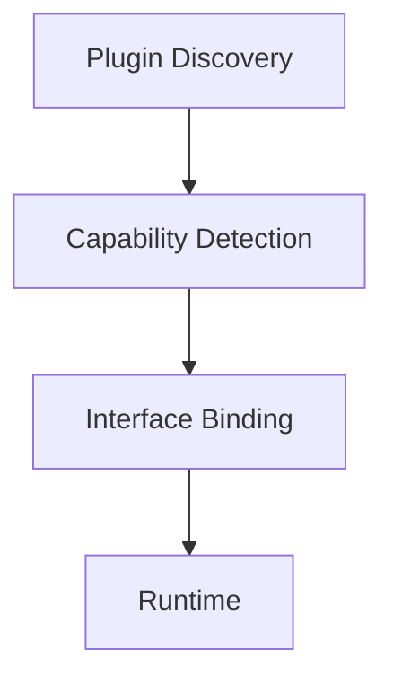

The addition of new hardware would not require a change in the core code.

---

# 11. API design principles

API must:

| Principles | Request |
|---|---|
| Stabilization | No change due to internal changes. |
| Independence | API does not expose Windows API, Linux API, AMD API, NVIDIA API. |
| Versionable | Use `v1`, `v2`, `v3` or Semantic Version. |

For example:

```text
ResourceController v1
```

Upgrade:

```text
ResourceController v2
```

The old application can still use v1.

---

# 12. Incident system

avoids direct calls between modules.

For example:

```text
Telemetry
 ↓
Policy
 ↓
Executor
```

All depend on.

Add:

```text
Event Bus
```

For example:

| Events |
|---|
| `SystemStateUpdated` |
| `TaskStarted` |
| `TaskFinished` |
| `ResourceChanged` |
| `UserContextChanged` |
| `PolicyUpdated` |
| `ExecutionCompleted` |

Thus:

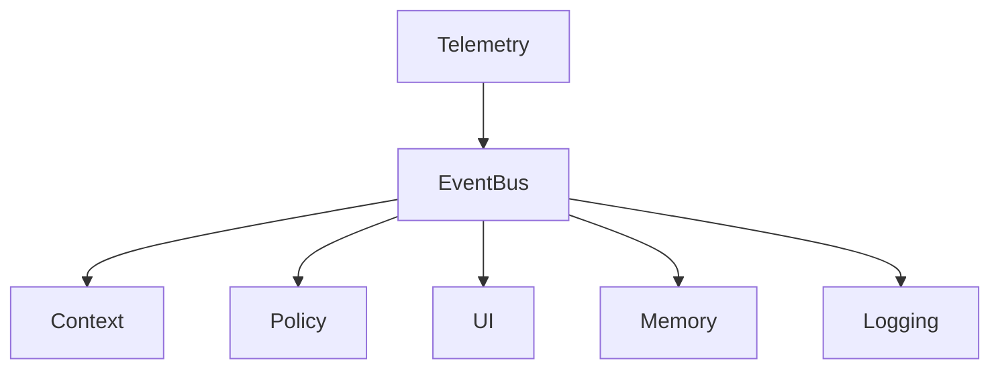

Keep each other low.

---

# 13. Data layer design

Data are divided into four categories.

| Data Type | Data | Storage policy |
|---|---|---|
| Realtime State | CPU、GPU、NPU、RAM、Temperature、Power | Do not save for long |
| Historical Data | Task、Runtime、Energy、Resource usage、Policy result | Long-term Save |
| User Profile | Preferences、Work habits、Power preference、Privacy preference | — |
| AI Memory | Prediction、Decision、Decision Result、Policy Effectiveness | — |

---

# 14. Test system

The project treats tests as production-quality code, not as a final afterthought.

The test layout is intentionally flat: keep one `tests/` directory and do not create `unit/`, `contract/`, or `integration/` subdirectories.

Test files use this format:

```text
featureName.behavior[.detail].test.extension
```

Of which:

| Name item | Rule |
|---|---|
| Feature name | lower camel case |
| Functional description | Camel Peak Naming |
| Additional functional description | Optional, humping name. |
| `test` | Fixed |
| Suffix Name | `.rs`, `.ts`, `.js`, etc. |

Example:

| Test Type | Example of filename |
|---|---|
| Unit Test | `context.buildState.unit.test.rs` |
| Unit Test | `policy.generatePolicy.unit.test.rs` |
| Unit Test | `prediction.predictLoad.unit.test.rs` |
| Unit Test | `validator.validatePolicy.unit.test.rs` |
| Unit Test | `scheduler.scheduleTask.unit.test.rs` |
| Unit Test | `memory.storeHistory.unit.test.rs` |
| Contract Test | `process.controller.contract.test.rs` |
| Contract Test | `adapter.windows.contract.test.rs` |
| Contract Test | `adapter.linux.contract.test.rs` |
| Integration Test | `pipeline.executePolicy.integration.test.rs` |
| Performance Test | `scheduler.measureLatency.performance.test.rs` |
| End-to-End Test | `system.startup.e2e.test.rs` |
| Failure Test | `executor.recoverFailure.failure.test.rs` |

### Unit Test

Test:

| Test Item |
|---|
| Context |
| Policy |
| Prediction |
| Validator |
| Scheduler |
| Memory |

---

### Contract Test

Ensure that the interface is not destroyed.

For example:

| Adapter |
|---|
| WindowsAdapter |
| LinuxAdapter |

It must be identical:

```text
IProcessController Contract
```

Test.

---

### Adapter Test

Separate tests:

| Adapter |
|---|
| Windows |
| Linux |
| AMD |
| Intel |
| NVIDIA |

---

### Integration Test

Test:

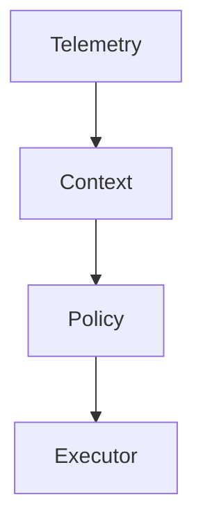

The whole chain.

---

### Performance Test

It must be determined that:

| Indicators |
|---|
| CPU overhead |
| Memory overhead |
| AI inference overhead |
| Scheduling latency |
| Decision latency |
| Policy execution latency |

---

### End-to-End Test

For example:

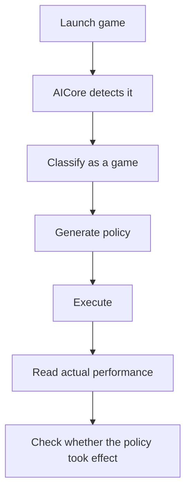

---

### Failure Test

Intentional manufacture of:

| Fault |
|---|
| AI model crash |
| Adapter crash |
| NPU not available |
| GPU not available |
| Insufficient Permissions |
| System API does not exist |
| Strategy is illegal. |
| Hardware suddenly disconnected. |

The system must:

```text
Fail Safe
```

Instead of:

```text
AI crashes
→
Computer crashes
```

---

# 15. Document system

The project document must be developed with the code.

```text
docs/
│
├── architecture/
│   ├── overview.md
│   ├── control-plane.md
│   ├── data-plane.md
│   └── adapter-architecture.md
│
├── api/
│   ├── public-api.md
│   ├── task-contract.md
│   ├── policy-contract.md
│   └── plugin-api.md
│
├── modules/
│   ├── telemetry.md
│   ├── context.md
│   ├── policy.md
│   ├── executor.md
│   └── memory.md
│
├── development/
│   ├── setup.md
│   ├── coding-style.md
│   ├── contribution.md
│   └── build.md
│
├── testing/
│   ├── strategy.md
│   ├── benchmarks.md
│   └── compatibility.md
│
├── decisions/
│   ├── ADR-001-core-architecture.md
│   ├── ADR-002-plugin-system.md
│   ├── ADR-003-ai-control-loop.md
│   └── ADR-004-cross-platform.md
│
└── compatibility/
    ├── windows.md
    └── linux.md
```

---

# 16. Basic principles for software development

The entire project must comply with:

| Principles | Request |
|---|---|
| Single Responsibility | Each module has a single responsibility. |
| Open/Closed | Add a GPU, NPU, OS, or model through extension points instead of modifying Core. |
| Liskov Substitution | Interfaces achieve interchangeability without disrupting core behaviour. |
| Interface Segregation | Split interfaces on duty to avoid unnecessary reliance. |
| Dependency Inversion | Core relies on interfaces rather than Windows/Linux. |
| High cohesion | Keep closely related behavior together; for example, `PolicyEngine` is responsible only for policy. |
| Low coupling | Communicate through interfaces, events, contracts, and DTOs. |

---

# 17. Cross-platform structure

Harmonization:

```text
AICore Core
```

Platform differences:

```text
Platform Adapter
```

For example:

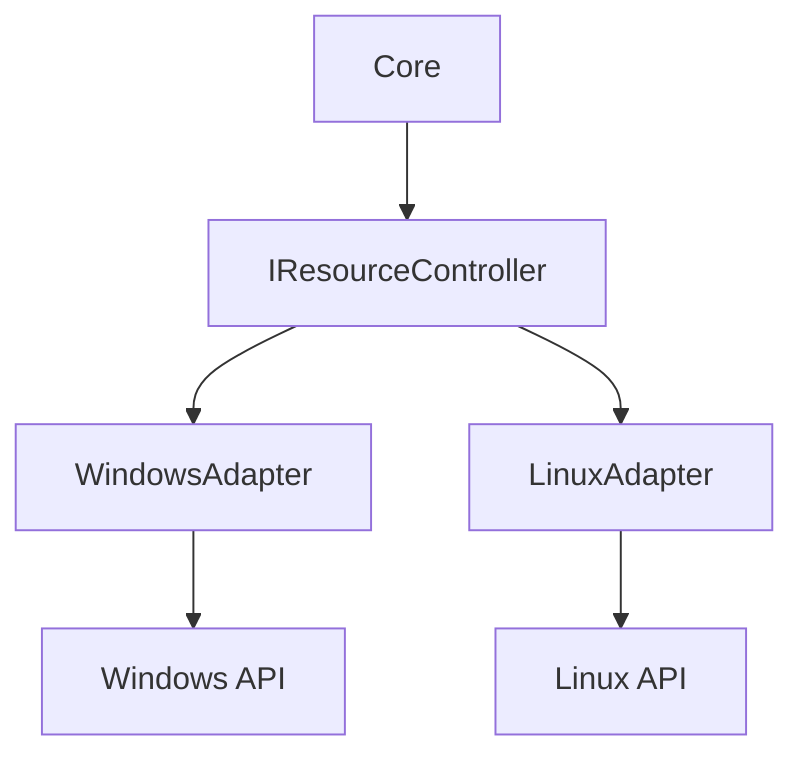

Similarly:

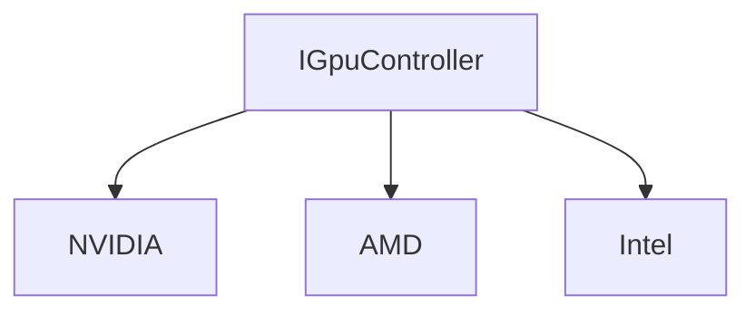

The core code is never realized.

---

# 18. Recommended technology warehouse

| Layer | Technology | Annotations |
|---|---|---|
| Core | Rust | Priority. Performance, security, cross-platform, low memory occupancy, suitable for system-level resident service. |
| Core (prototype) | C++ | You can also use it at the prototype stage. Long-term advice is to use Rust or Rust +C/C+Adapter. |
| AI | ONNX Runtime、llama.cpp、ONNX、Windows ML、Vendor Runtime | Models can be replaced and the core does not bind a model. |
| API | IPC、gRPC、Unix Domain Socket、Named Pipe | Windows uses Named Pipe / Local IPC; Linux uses UNIX Domain Socket. |
| UI | Web UI、Electron、Tauri | If the core is Rust, Tauri is recommended, so the resident service is separated from UI. |

---

# 19. Product operating structure

Final recommendations:

```text
AICore
│
├── aicored
│   └── Core Service
│
├── aicore-agent
│   └── AI / Prediction
│
├── aicore-adapter
│   ├── Windows
│   └── Linux
│
├── aicore-cli
│
└── aicore-ui
```

Of which:

```text
aicored
```

Always run.

UI：

```text
Optional
```

Even if UI is closed:

> AICore is still functioning.

---

# 20. Product running time data stream

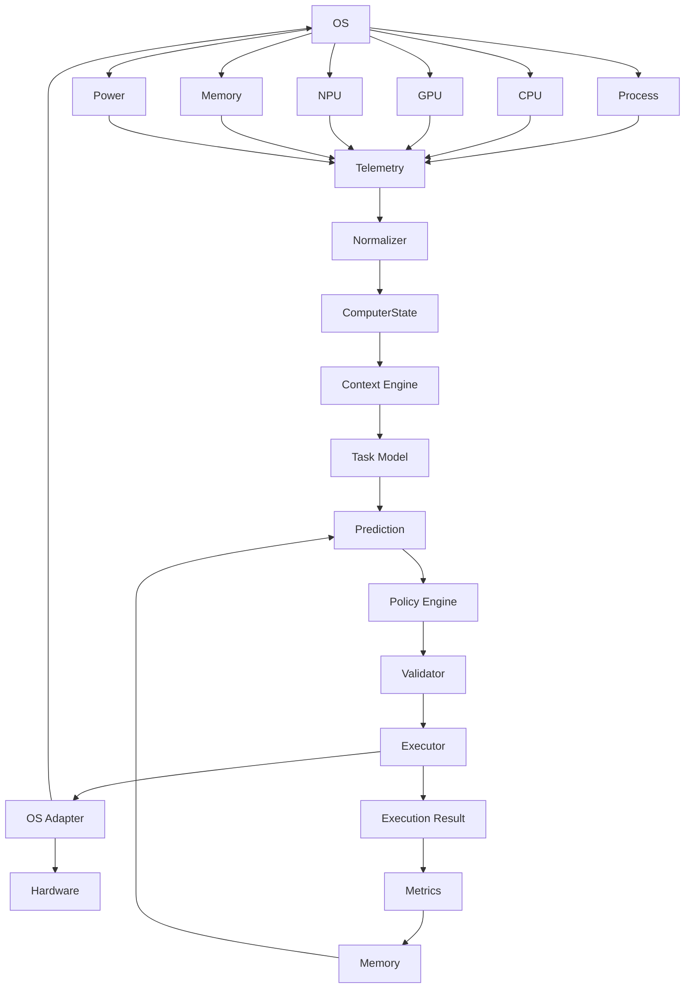

Form a closed ring.

---

# 21. Principles of security

AICore is a system-level product and must therefore comply with:

> AI can never have unlimited system control.

All operations must go through:

```text
Permission
Capability
Validation
Policy
```

For example:

```text
AI：
Terminate process X

Validator：
Allow?

Security Policy：
No

Executor：
Deny
```

Meanwhile, all implementation records:

```text
Decision
Reason
Policy
Result
```

Must be traceable.

---

# 22. Observation

The product must record:

```text
AI Decision
Policy
Execution
Latency
Resource Effect
Failure
```

For example:

```text
10:00:01
Task detected: Coding

10:00:01
Policy:
CPU = High
NPU = Normal
Background = Low

10:00:02
Execution successful

10:00:05
CPU latency improved 12%
```

That's how we know:

> AI does not really optimize the system.

---

# 23. Core product indicators

We can't just watch:

```text
AI model accuracy
```

It should be seen:

### User Experience

```text
Latency
Responsiveness
Startup Time
Task Completion Time
```

### System

```text
CPU overhead
Memory overhead
Energy consumption
Temperature
```

### AI

```text
Prediction Accuracy
Policy Accuracy
Decision Latency
Inference Cost
```

### Stability

```text
Crash Rate
Recovery Rate
Adapter Failure Rate
Policy Rejection Rate
```

---

# 24. Release 1 MVP

The first version does not attempt to complete AI Computer.

Only:

```text
Windows
+
Linux
+
CPU
+
GPU
+
NPU (when available)
+
Process
+
Memory
+
Power
```

The MVP delivers:

```text
1. System Observer

2. Workload Classifier

3. Policy Engine

4. Resource Executor

5. Basic AI Prediction

6. Dashboard

7. Logs

8. Testing Framework

9. Plugin System
```

The first edition is suspended:

```text
Kernel scheduler
Advanced agent
Deep personal model
Automatically modify all system parameters
Complex long-term learning
Mac
```

---

# 25. MVP product effects

Users see:

```text
AICore

System
CPU       31%
GPU       18%
NPU       0%
RAM       62%

Current Task
Development

AI Decision
CPU        HIGH
GPU        NORMAL
NPU        AVAILABLE
Background LOW

Reason
Interactive development workload detected.
```

Not a bunch of technical parameters.

---

# 26. V2

Add:

```text
LLM Agent
Personal Memory
Application Integration
Predictive Scheduling
Cross-device model support
```

System starts:

> See what the users will do next.

---

# 27. V3

Add:

```text
Deep OS Integration
Advanced GPU/NPU scheduling
Kernel integration where justified
Thermal management
Power optimization
AI Agent orchestration
```

Eventually:

```text
AI-native Computer Control Layer
```

---

# 28. Final product architecture objectives

Eventually:

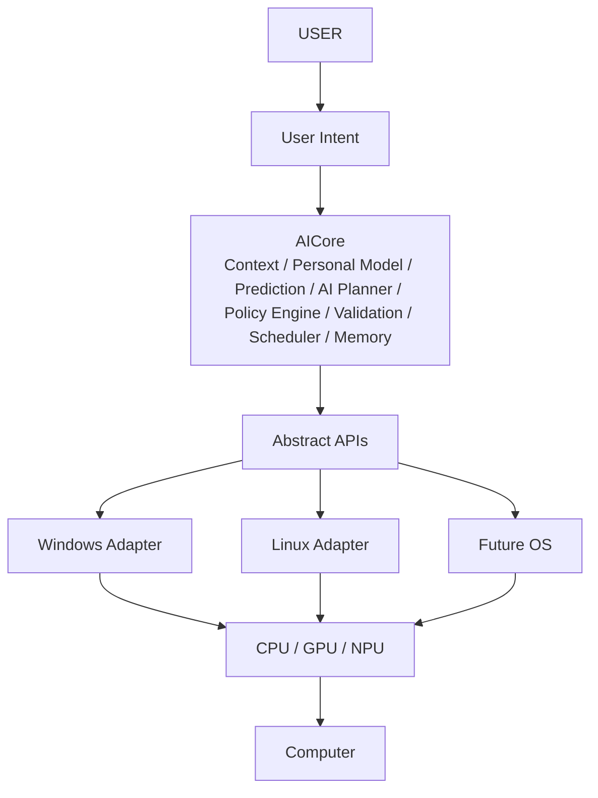

---

# 29. Project success criteria

AICore Not:

> "AI Model size"

Or:

> How many codes?

As a criterion for success.

They are:

| Standard | Request |
|---|---|
| First criterion | Users do not need to manually set complex energy parameters. |
| Second criterion | The system identifies the current task. |
| Third criterion | The system automatically generates a rational resource strategy. |
| Standard IV | The strategy really affects Performance, Latency, Energy, Responsibility. |
| Fifth criterion | Replacement OS、Hardware、AI Model、Adapter No big modifications. Core。 |
| Standard VI | All modules have Internet, Test, Documentation. |
| Standard VII | AI can fail when an anomaly occurs, but the operating system cannot fail because AI failed. |

---

# 30. Final positioning of the project

AICore is not ultimately an:

> AI Assistant

Nor is it merely a:

> PC Optimizer

It is an:

## **AI Computer Control Layer**

That is:

> **An intelligent control layer connecting users, applications, operating systems, and computing hardware.**

Its ultimate objectives are:

```text
Software
     ↓
Intent
     ↓
AI Understanding
     ↓
System Policy
     ↓
Resource Orchestration
     ↓
Hardware
```

So let the computer get from:

> **Software-defined Computer**

Gradually:

> **AI-managed Computer**

---

# 31. Order of recommended project development

Practical development is strictly governed by:

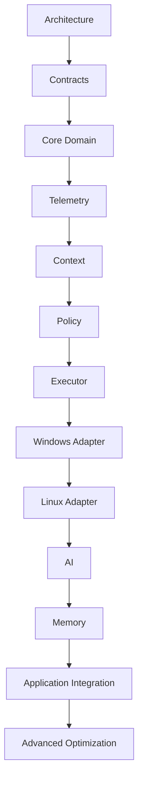

Instead of:

```text
Build the UI first
↓
Then add AI
↓
Finally add system functions
```

---

# 32. The most important engineering rules of the project

The following rules have long been observed throughout the project:

| Numbering | Engineering rules |
|---:|---|
| 1 | Core does not depend on Platform |
| 2 | Core does not depend on UI |
| 3 | Core does not rely on specific AI Model |
| 4 | Core does not depend on specific Hardware Vendor |
| 5 | Adapter does not contain business logic |
| 6 | UI does not directly access OS |
| 7 | AI does not directly perform system operations |
| 8 | All systems are operated by Execuator |
| 9 | All strategies pass through Validator. |
| 10 | All cross-module communications via Interface / Event / Contact |
| 11 | Every public interface must be tested. |
| 12 | Every platform Adapter must have Contractor Test |
| 13 | Every major structural decision must record ADR |
| 14 | Each module must have a separate document |
| 15 | Any new functionality must give priority to being added as a new module/plugin |

---

# 33. Final objectives

AICore finally hopes to form:

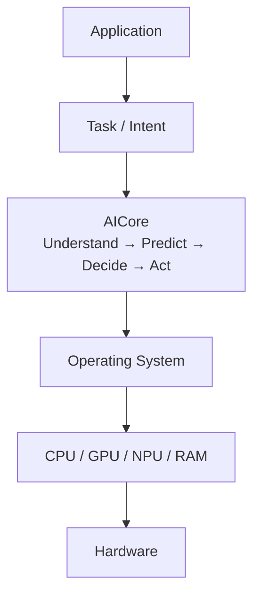

In concrete terms:

> **The application tells the computer what it intends to do. The AI control layer interprets the context and proposes what should happen next. The operating system executes safely, and the hardware performs the computation.**

The result is a cohesive, loosely coupled, black-boxed, interface-driven, cross-platform, and extensible **AI-native control layer**.
