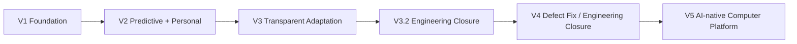

[English](PRODUCT_EVOLUTION.md) | [Chinese](PRODUCT_EVOLUTION.zh-CN.md)
# Product Evolution

Versions represent capability evolution rather than separate documentation trees:

All versions share the same `docs/` architecture baseline; the current status is based on engineering status and validation records, and future targets are maintained through independent planning materials.
