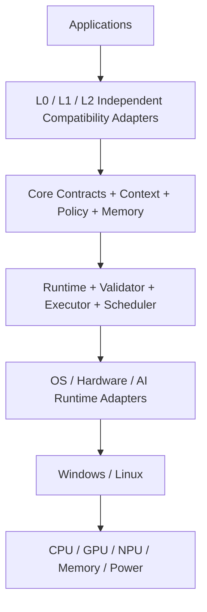

[English](SYSTEM_BOUNDARY.md) | [Chinese](SYSTEM_BOUNDARY.zh-CN.md)
# System Boundary

## AICore owns

- Context and workload inference
- Policy creation and resolution
- Validation
- Runtime orchestration
- Compatibility adapters
- Historical memory and policy effectiveness
- IPC / Plugin control plane
- Dashboard data plane

## AICore does not own

- Application business logic
- GPU/NPU firmware
- Vendor driver implementation
- Kernel implementation unless future integration requires it
- Model training infrastructure
