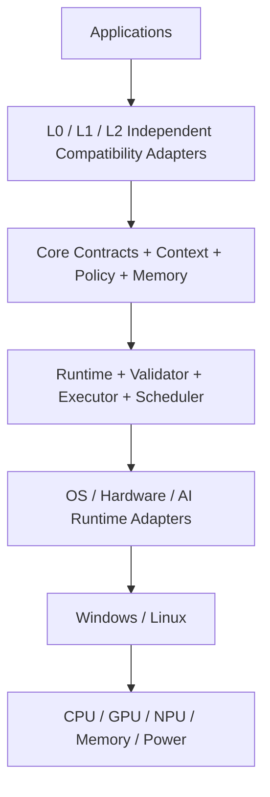

[英文](SYSTEM_BOUNDARY.md) | [中文](SYSTEM_BOUNDARY.zh-CN.md)

# 系统边界

## AICore 拥有

- 上下文与工作负载推断
- 策略生成与冲突处理
- 验证
- 运行时编排
- 兼容性适配器
- 历史记忆与策略效果
- IPC / 插件控制平面
- 仪表盘数据平面

## AICore 不拥有

- 应用程序业务逻辑
- GPU/NPU 固件
- 厂商驱动实现
- 内核实现，除非未来集成证明有必要
- 模型训练基础设施
