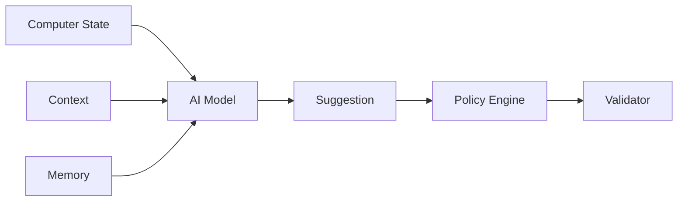

# AI Architecture

AI 模型是可替换的 Provider/Runtime，不得成为 Core 的硬依赖。

## Model 类别

- deterministic rules
- lightweight local feature models
- SLM/LLM
- ONNX models
- vendor-accelerated models

AI 不负责最终执行授权。
