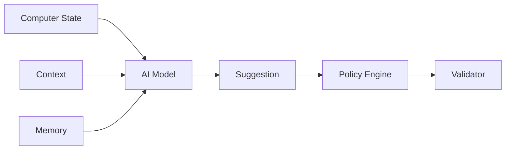

[English](AI_ARCHITECTURE.md) | [Chinese](AI_ARCHITECTURE.zh-CN.md)
# AI Architecture

AI models are replaceable providers or runtimes. Core must not depend on a specific model implementation.

## Model categories

- deterministic rules
- lightweight local feature models
- SLM/LLM
- ONNX models
- vendor-accelerated models

AI does not authorize or perform final execution.
