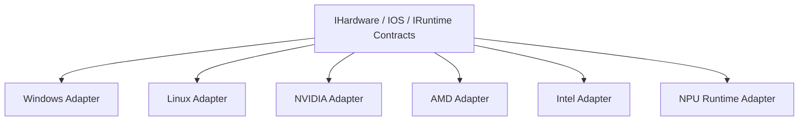

[English](ADAPTER_PLANE.md) | [Chinese](ADAPTER_PLANE.zh-CN.md)
# Adapter Plane

The adapter plane is the only layer that contains platform- and hardware-specific behavior.

Adapters do not define policy, retain history, or own UI state.
