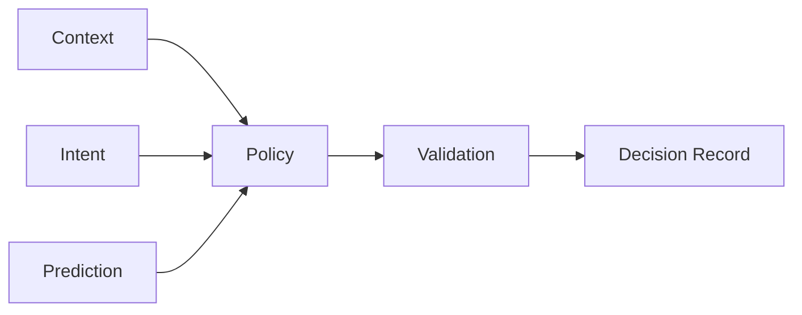

# Control Plane

Control Plane 负责决定“应该怎么运行”，不负责亲自提供平台能力。

| 模块 | 职责 | 禁止职责 |
|---|---|---|
| Context | 当前任务/环境 | 直接修改 OS |
| Prediction | 预测未来状态 | 直接执行 |
| Policy | 生成策略 | 直接调用 vendor API |
| Validator | 检查安全/能力/冲突 | 创建业务策略 |
| Decision Record | 留存原因和结果 | 修改资源 |
