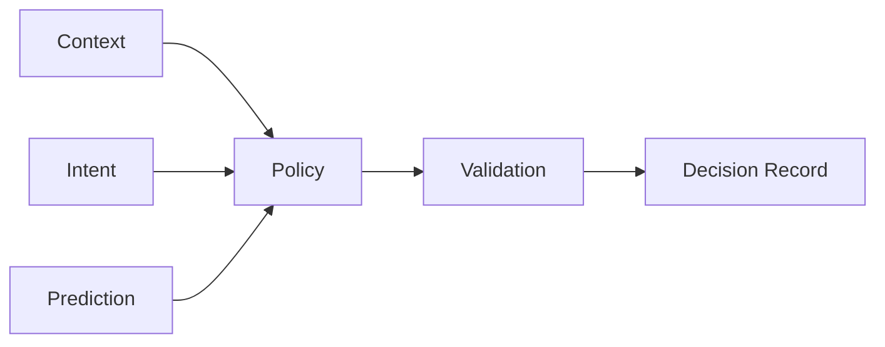

[English](CONTROL_PLANE.md) | [Chinese](CONTROL_PLANE.zh-CN.md)
# Control Plane

The control plane decides how the system should run. It does not implement platform capabilities directly.

| Module | Responsibility | Must not |
|---|---|---|
| Context | Represent the current task and environment | Modify the OS directly |
| Prediction | Forecast near-term state | Execute changes directly |
| Policy | Produce resource policy | Call vendor APIs directly |
| Validator | Check safety, capabilities, and conflicts | Invent business policy |
| Decision Record | Retain reasons and outcomes | Modify resources |
