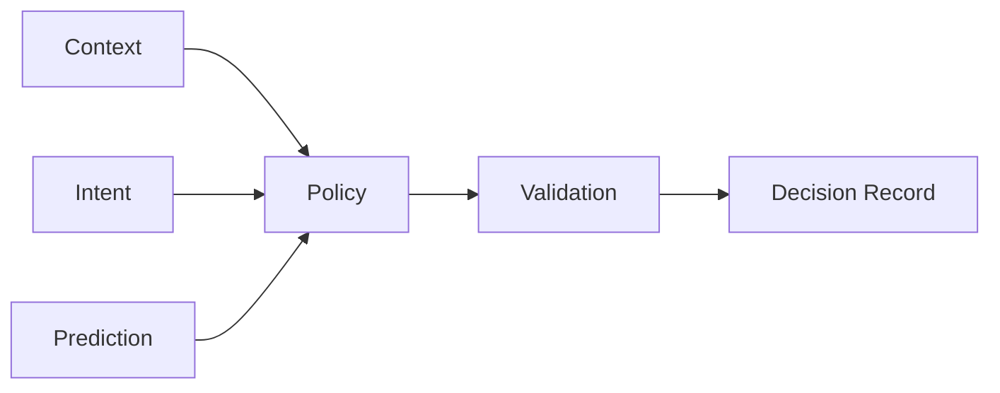

[英文](CONTROL_PLANE.md) | [中文](CONTROL_PLANE.zh-CN.md)

# 控制平面

控制平面负责决定“应该怎么运行”，不负责直接提供平台能力。

| 模块 | 职责 | 禁止职责 |
|---|---|---|
| 上下文 | 当前任务与环境 | 直接修改操作系统 |
| 预测 | 预测未来状态 | 直接执行 |
| 策略 | 生成资源策略 | 直接调用厂商 API |
| 校验器 | 检查安全、能力与冲突 | 创建业务策略 |
| 决策记录 | 留存原因和结果 | 修改资源 |
