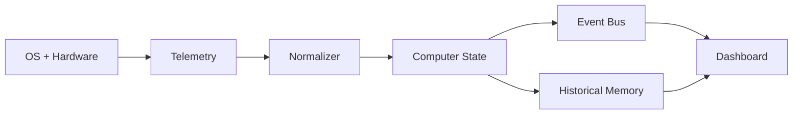

[English](DATA_PLANE.md) | [Chinese](DATA_PLANE.zh-CN.md)
# Data Plane

The data plane must ensure that:

- Terminal and web dashboards use the same source.
- Real-time state remains separate from historical data.
- UI code does not access the OS directly.
- High-frequency data collection does not block the control plane.
