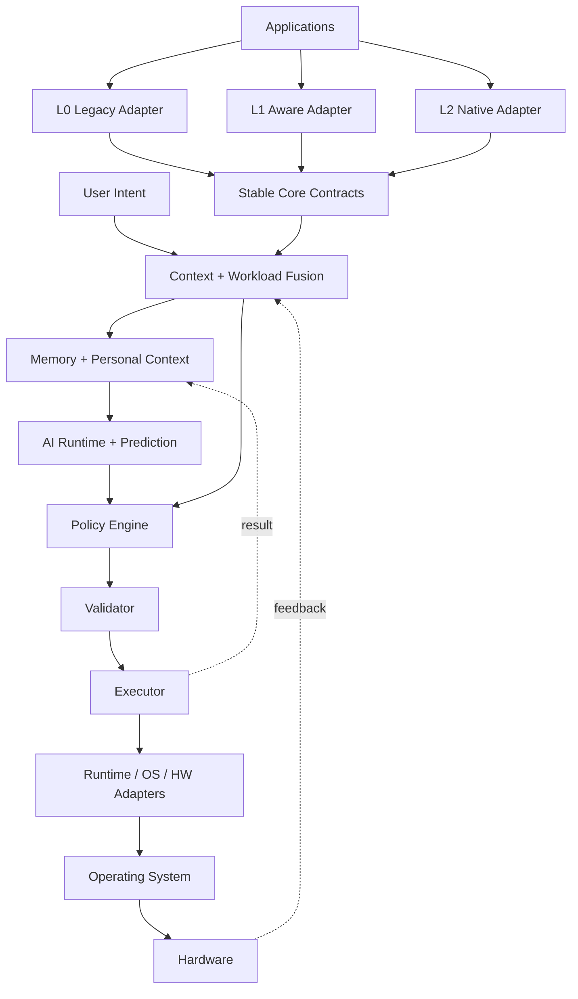

[English](SYSTEM_ARCHITECTURE.md) | [Chinese](SYSTEM_ARCHITECTURE.zh-CN.md)
# System Architecture

## Dependency direction

`Application/Tier → Contracts → Core → Runtime → Adapter → OS/Hardware`.

Core never depends directly on Windows, Linux, a hardware vendor, or an LLM.

## AI Control Chain

AICore follows the control flow:

Observe → Understand → Predict → Decide → Validate → Execute → Measure → Learn

The control chain converts observed system state into validated execution decisions.
