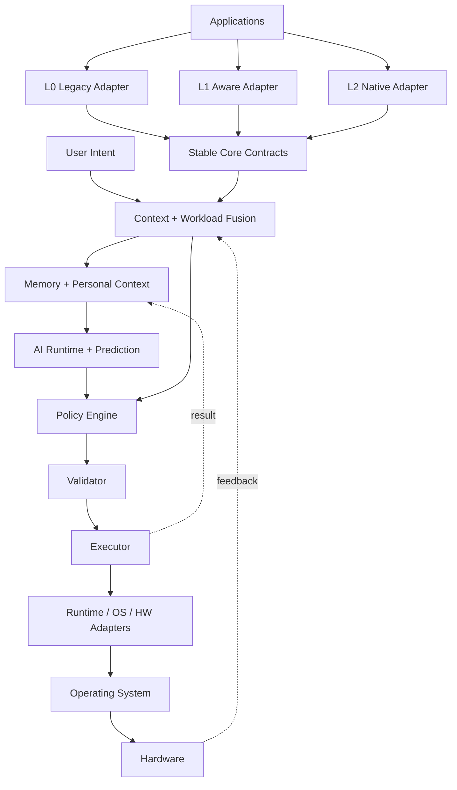

[英文](SYSTEM_ARCHITECTURE.md) | [中文](SYSTEM_ARCHITECTURE.zh-CN.md)

# 系统架构

## 不变的依赖方向

`Application/Tier → Contracts → Core → Runtime → Adapter → OS/Hardware`。

核心层永远不直接依赖 Windows、Linux、厂商实现或语言模型。

## AI 控制链

AICore 遵循以下控制流程：

观察 → 理解 → 预测 → 决策 → 校验 → 执行 → 测量 → 学习

控制链将观测到的系统状态转化为经过校验的执行决策。
