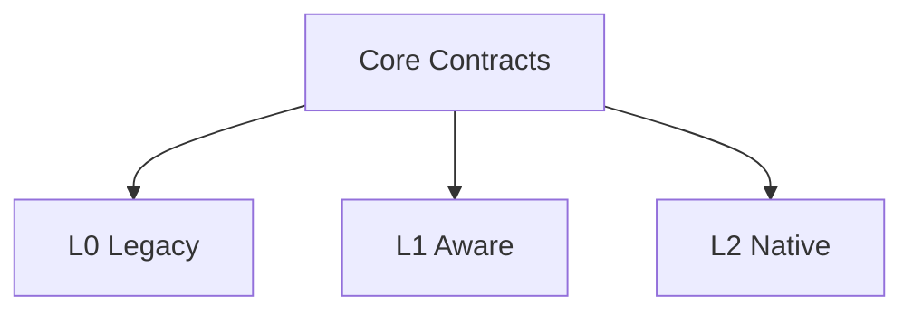

[English](COMPATIBILITY_MODEL.md) | [Chinese](COMPATIBILITY_MODEL.zh-CN.md)
# Compatibility Model

AICore supports three independent compatibility paths.

| Tier | Application changes | Primary capability |
|---|---:|---|
| L0 Legacy | None | Process, window, and resource observation; workload inference; transparent policy |
| L1 Aware | Optional | Application declarations |
| L2 Native | Optional | Direct use of the AICore native API |

The three tiers are peers. They do not call one another and depend only on Core contracts.

Removing any tier must not require changes to Core or the other tiers.
