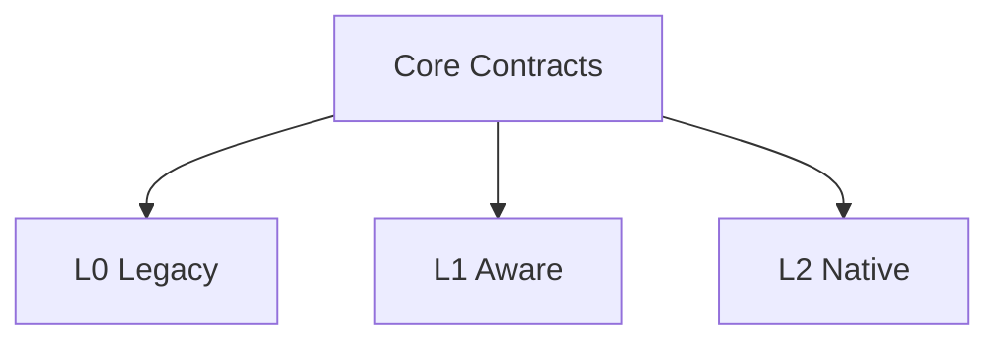

# Compatibility Model

AICore 必须支持三种独立兼容路径。

| Tier | 应用是否修改 | 主要能力 |
|---|---:|---|
| L0 Legacy | 否 | 进程/窗口/资源观察、Workload 推断、透明策略 |
| L1 Aware | 可选 | 应用声明 Task/Intent/Resource Hint |
| L2 Native | 可选 | 应用直接调用 AICore Native API |

三种 Tier 平级、互不调用，只依赖 Core Contracts。

删除任一 Tier 时，其他 Tier 不应需要修改 Core。
