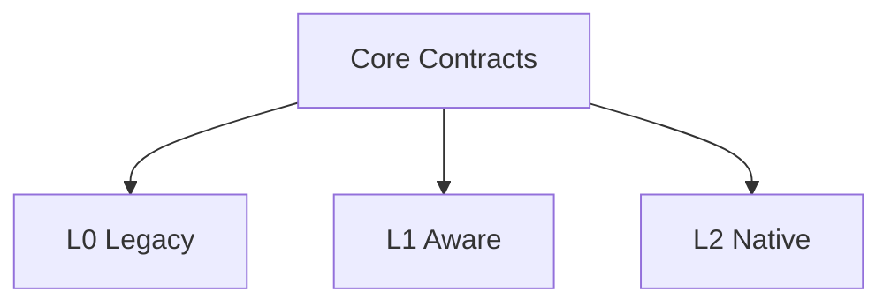

[英文](COMPATIBILITY_MODEL.md) | [中文](COMPATIBILITY_MODEL.zh-CN.md)

# 兼容性模型

AICore 必须支持三种独立兼容路径。

| 层级 | 应用是否修改 | 主要能力 |
|---|---:|---|
| L0 传统应用 | 否 | 进程、窗口和资源观察；工作负载推断；透明策略 |
| L1 感知应用 | 可选 | 应用声明任务、意图和资源提示 |
| L2 原生应用 | 可选 | 应用直接调用 AICore 原生 API |

三种层级平级、互不调用，只依赖核心契约。

删除任一层级时，其他层级不应需要修改核心层。
