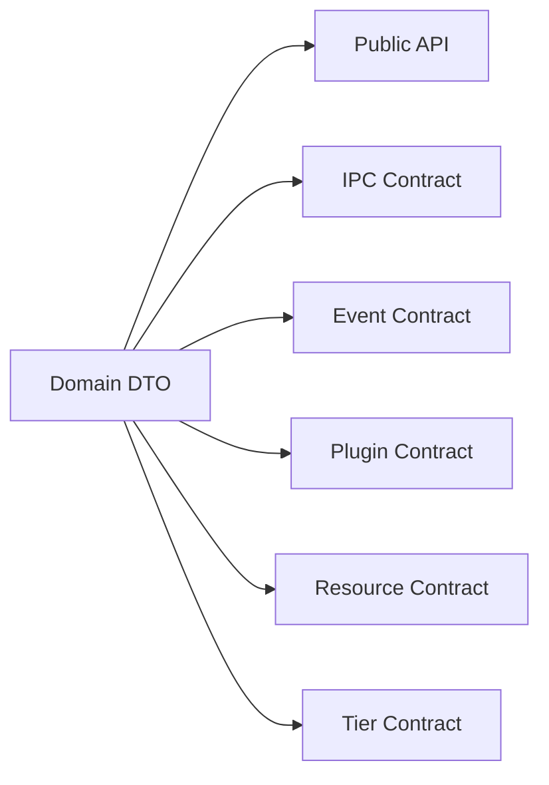

[English](CONTRACT_ARCHITECTURE.md) | [Chinese](CONTRACT_ARCHITECTURE.zh-CN.md)
# Contract Architecture

Contracts define the system's stable long-term boundaries.

## Rule

- Use one canonical error model.
- Use one canonical schema-version model.
- Represent cross-module timestamps consistently as `unix_ms`.
- Do not maintain duplicate structures for the same domain concept.
- Contract changes require review and contract tests.
