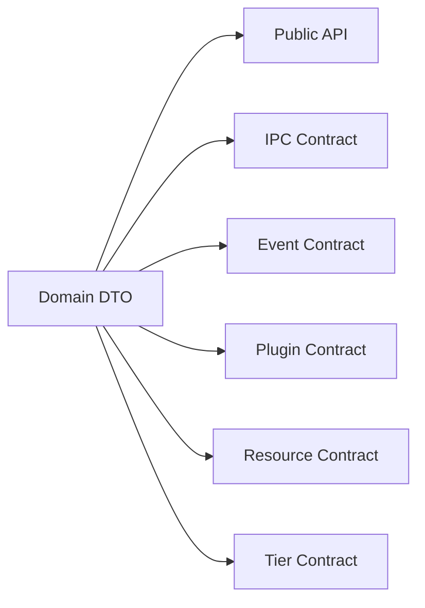

# Contract Architecture

Contracts 是整个系统的长期边界。

## 规则

- 一个 canonical error model。
- 一个 canonical schema version model。
- 跨模块时间统一 `unix_ms`。
- 不为同一业务语义维护多个重复结构。
- Contract 改动必须有 compatibility review 和 contract tests。
