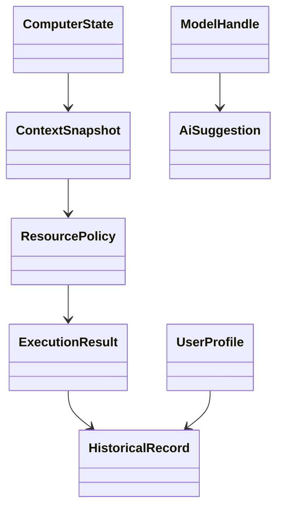

# Data Model

核心实体：

### 核心实体规则

| Entity | 作用 |
|---|---|
| ComputerState | 实时系统状态 |
| ContextSnapshot | 当前任务上下文 |
| ResourcePolicy | 决策结果 |
| ExecutionResult | 实际执行结果 |
| HistoricalRecord | 长期反馈 |
| UserProfile | 稳定用户偏好 |
| AiSuggestion | AI 建议，不等价于执行 |
