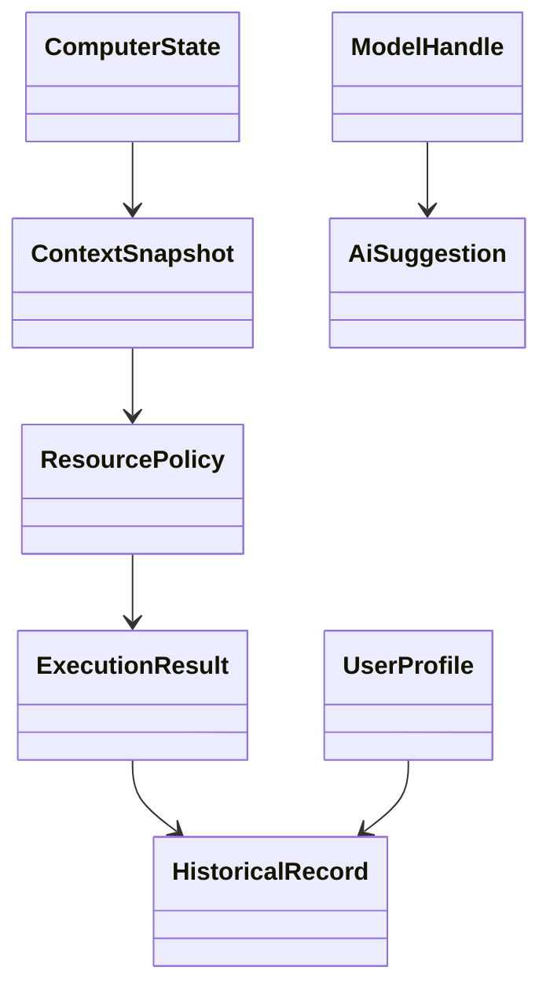

[English](DATA_MODEL.md) | [Chinese](DATA_MODEL.zh-CN.md)
# Data Model

Core entities:

### Core entity rules

| Entity | Role |
|---|---|
| ComputerState | Real-time system state |
| ContextSnapshot | Context of the current task |
| ResourcePolicy | Resource-control decision |
| ExecutionResult | Observed execution outcome |
| HistoricalRecord | Long-term feedback |
| UserProfile | Stable user preferences |
| AiSuggestion | Advisory AI output, never an authorization |
