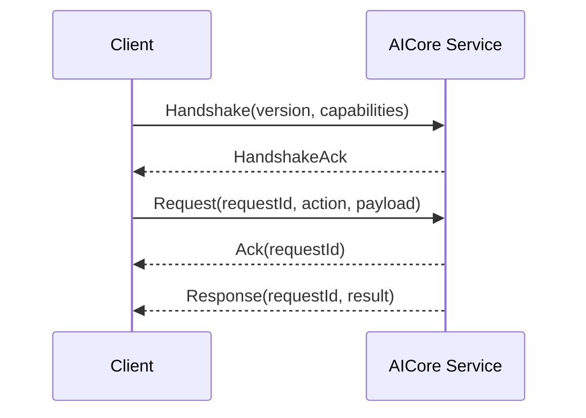

[English](IPC_PROTOCOL.md) | [Chinese](IPC_PROTOCOL.zh-CN.md)
# IPC Protocol

## Must have

- `protocol_version`
- `request_id`
- `action`
- capability handshake
- Ack
- duplicate request protection
- bounded concurrency/backpressure
- local authentication/permission
- timeout
- deterministic error model

## Current implementation (destination work in progress)

`IpcClient::connect` first sends `Handshake { capabilities: ["request_ack"] }`.
The service returns `HandshakeAck`. After successful negotiation, every valid request receives an `Ack` and
final `Response` with the same `request_id`. Legacy clients that do not send a handshake retain the single-response
flow. Versions `1.0` and `2.0` are explicitly supported. Version `2.0` uses the same typed payloads but requires a
negotiated session. A current handshake supplies `supported_versions`; the service selects the highest mutually
supported version and returns it in the response envelope. The request, acknowledgement, and response must all use
the selected version, and the client checks both version and request ID. A legacy handshake without a version list
uses its envelope version; an unnegotiated `2.0` request is rejected. `IpcClient::connect` defaults to `1.0`, while
`connect_with_versions` can offer `[2.0, 1.0]`. Supporting these versions does not imply compatibility with an
arbitrary future major version. Same-user Windows named-pipe tests cover `2.0` negotiation, Ack, and GetStatus.

The Linux Unix-domain socket uses owner-only `0600` permissions. On connection, the service extracts the peer
UID and PID, the process start time from `/proc/<pid>/stat`, and the executable device and inode from
`/proc/<pid>/exe`. Missing identity or a different UID is rejected. Application requests revalidate the live
identity, including executable replacement, and fail closed when identity cannot be read. The service permits at
most 32 connections and closes an idle connection after 30 seconds. Request-ID deduplication spans one connection;
after 4096 IDs, the service closes that connection rather than claiming persistent idempotency across connections.
A duplicate ID returns an error without calling the business handler again.

The Windows named-pipe implementation creates a restricted DACL for the owner and `LocalSystem`, rejects remote
clients, requests first-instance ownership of the pipe name, and keeps a waiting instance to prevent a creation-gap
takeover. It extracts the client PID and process creation time. MSVC target compilation and same-user runtime checks
for peer identity, executable SHA-256, and SID policy have passed. Cross-user ACL rejection is not yet certified.

`Register` binds an application ID to the current operating-system peer identity. Later requests that change the
application's state or tasks must match that identity, and another peer cannot take over the registered ID. On
Linux, reconnection reclaims a binding and clears the L1 declaration only after confirming that the old PID is gone
or its start time, UID, or executable identity changed. A read failure preserves the old binding to prevent an
incorrect takeover. Windows code also checks process exit and PID or creation-time changes, but cross-user ACL and
stale-binding cleanup do not yet have complete native matrix evidence.

When `AICORE_APP_POLICY_PATH` is configured, every pinned action requires the executable SHA-256, an action-specific
grant, and a nonempty `allowed_principals` entry containing a Windows SID or Linux `uid:<number>`. These values are
resolved read-only from the authenticated peer and cannot be asserted by the request body. Missing or mismatched
identity is rejected. An empty principal list retains legacy artifact-only policy. A file digest is not equivalent
to signature verification or proof of the loaded process image. Closing a connection does not immediately cancel
tasks; periodic stale-identity cleanup cancels active queued tasks and removes the application's L1 and registration
state after it confirms that the process exited or its identity changed.

Application requests include `Register`, `Unregister`, and `SubmitTask`, plus `DeclareCurrentTask` and
`ClearCurrentTask` for L1, and `SubmitNativeTask`, `GetNativeTask`, and `CancelNativeTask` for the shared L2 queue
lifecycle. L2 queries and cancellation verify both the application ID in the handle and current peer ownership.
The L2 provider operates only on handles it created. `SubmitNativeTask` enters the existing task queue and does not
directly trigger host execution.

`PrepareUpcomingTask` creates an application resource-preparation task and requires a separate `prepare_task` grant
plus consent for personal memory. See [Scheduling and Feedback](../runtime/SCHEDULING_AND_FEEDBACK.md).
Configuration for the local JSON, ONNX, Ollama, and collaborative `ProposeIntent` backends is documented in
[Intent Backends](../ai/INTENT_BACKENDS.md).
