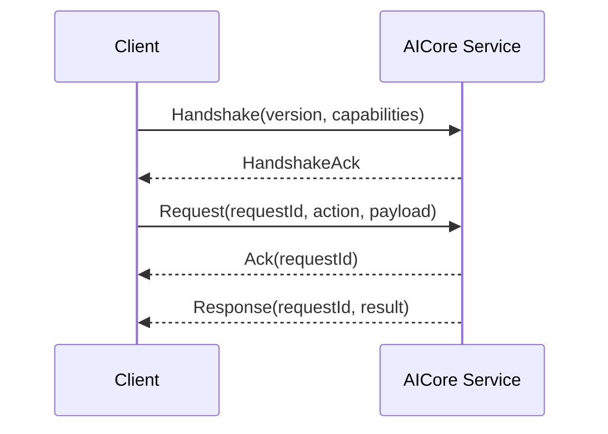

# IPC Protocol

## 必须具备

- `protocol_version`
- `request_id`
- `action`
- capability handshake
- Ack
- duplicate request protection
- bounded concurrency/backpressure
- local authentication/permission
- timeout
- deterministic error model
