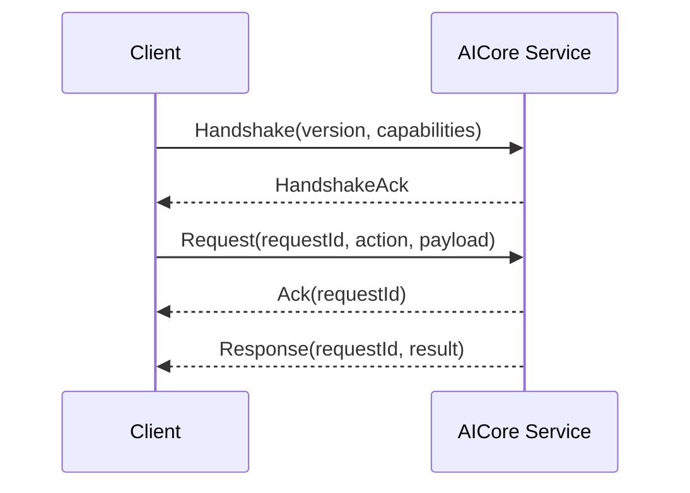

# IPC Protocol

## 必须具备

- `protocol_version`
- `request_id`
- `action`
- capability handshake
- Ack
- duplicate request protection
- bounded concurrency/backpressure
- local authentication/permission
- timeout
- deterministic error model

## 当前实现（destination 阶段进行中）

`IpcClient::connect` 首先发送 `Handshake { capabilities: ["request_ack"] }`。
服务端返回 `HandshakeAck`；协商成功后，每个合法请求依次收到同一
`request_id` 的 `Ack` 和最终 `Response`。未发送握手的旧客户端仍按
单响应流程处理。协议版本仍为 `1.0`；服务端拒绝不匹配的版本，
但尚未实现跨主版本协商，客户端仍需检查版本与 request ID。

Linux Unix socket 使用所有者 `0600` 权限，并在接受连接时提取 peer UID/PID
及 `/proc/<pid>/stat` 的进程启动 tick，拒绝不同 UID 或缺失身份的连接；
服务端最多保留 32 个连接，空闲连接 30 秒关闭。
request ID 去重覆盖单个连接的整个寿命；达到 4096 个 ID 后服务端关闭连接，
不提供跨连接的持久幂等性。重复 ID 返回错误，且不会再次调用业务处理器。
Windows named pipe 代码配置所有者和 LocalSystem 的受限 DACL，拒绝远程客户端；
首次创建要求独占 pipe 名称，并保留一个等待连接的实例防止空窗抢占。
服务端提取客户端 PID 与进程创建时间；MSVC 目标编译已检查，Windows 运行时
ACL/身份测试尚未执行。
`Register` 把应用 ID 绑定到当前连接的 OS peer 身份；后续修改应用状态或任务的
请求必须匹配该身份，其他 peer 不能接管同一个已注册 ID。此绑定目前是进程级，
UID/PID/启动时间或 PID/创建时间绑定可区分进程重用，但仍缺应用签名/SID
级声明、连接关闭后的失效策略和原生平台验证。

应用请求中已有 `Register`、`Unregister` 和 `SubmitTask`。当前还提供
`DeclareCurrentTask`、`ClearCurrentTask`（L1 当前任务）以及
`SubmitNativeTask`、`GetNativeTask`、`CancelNativeTask`（L2 共享队列生命周期）。
L2 查询/取消同时检查句柄应用 ID 与当前 peer 所有权，L2 提供者只操作自己创建的句柄。
`SubmitNativeTask` 进入现有任务队列，不直接触发宿主机执行。
