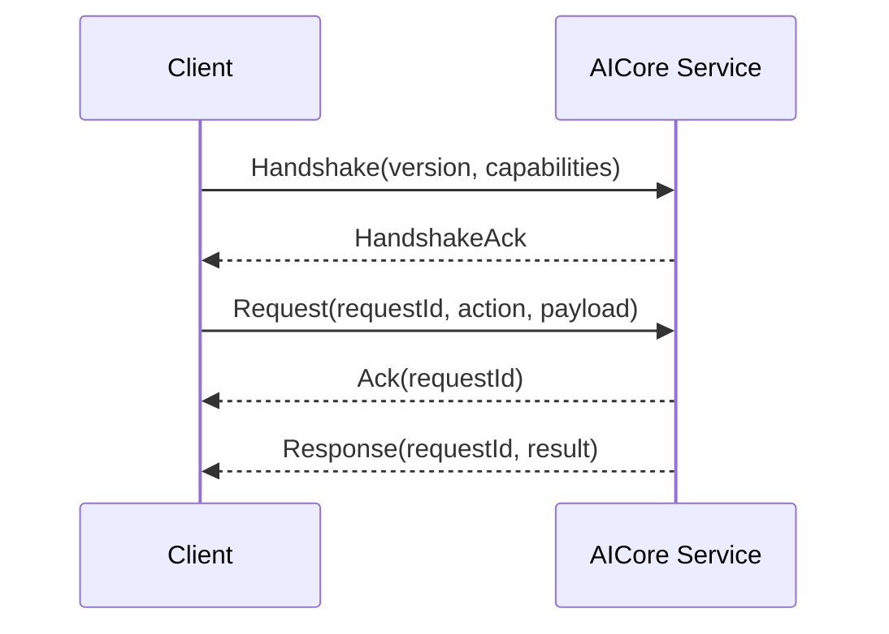

[英文](IPC_PROTOCOL.md) | [中文](IPC_PROTOCOL.zh-CN.md)

# IPC 协议

## 必须具备

- `protocol_version`
- `request_id`
- `action`
- 能力握手
- 确认消息
- 重复请求防护
- 有界并发与背压
- 本地身份认证与权限检查
- 超时处理
- 确定性错误模型

## 当前实现（目标设计阶段进行中）

`IpcClient::connect` 首先发送 `Handshake { capabilities: ["request_ack"] }`。
服务端返回 `HandshakeAck`；协商成功后，每个合法请求依次收到同一
`request_id` 的 `Ack` 和最终 `Response`。未发送握手的旧客户端仍按
单响应流程处理。支持 `1.0` 和 `2.0`：`2.0` 使用相同的类型化载荷，
但要求先建立协商会话。新版握手列出 `supported_versions`，服务端选择双方
支持的最高版本，响应封装中给出选定版本；仅提供不支持的版本会失败。
非握手请求、确认和响应必须使用该连接的选定版本，客户端检查版本与
请求标识。旧握手不带列表时按封装版本处理；未握手的 `2.0`
请求会被拒绝。`IpcClient::connect` 默认使用 `1.0`，
`connect_with_versions` 可提供 `[2.0, 1.0]`。这是两个明确支持的版本，
不表示任意未来主版本兼容。Windows 同用户命名管道测试已覆盖 `2.0`
握手、Ack 与 GetStatus。

Linux Unix 域套接字使用所有者 `0600` 权限，并在接受连接时提取对端 UID/PID、
`/proc/<pid>/stat` 的进程启动时刻及 `/proc/<pid>/exe` 的设备号和索引节点；
缺失身份或不同 UID 的连接被拒绝。应用相关请求再次核对实时身份，
包括可执行文件是否已变更；无法读取时拒绝该请求。
服务端最多保留 32 个连接，空闲连接 30 秒关闭。
请求标识去重覆盖单个连接的整个寿命；达到 4096 个标识后服务端关闭连接，
不提供跨连接的持久幂等性。重复标识返回错误，且不会再次调用业务处理器。
Windows 命名管道代码配置所有者和 `LocalSystem` 的受限访问控制列表，拒绝远程客户端；
首次创建要求独占管道名称，并保留一个等待连接的实例防止空窗抢占。
服务端提取客户端 PID 与进程创建时间；MSVC 目标编译已检查，Windows 运行时
同用户身份、可执行文件 SHA-256 与 SID 策略已运行验证；跨用户访问控制拒绝
仍未认证。
`Register` 把应用标识绑定到当前连接的操作系统对端身份；后续修改应用状态或任务的
请求必须匹配该身份，其他对端不能接管同一个已注册标识。Linux 注册重连时
会确认旧 PID 消失或启动时间、UID、可执行文件身份变化后回收绑定并清除
L1 声明；读取失败时保留旧绑定，防止误接管。Windows 代码也检查进程退出或 PID、创建时间变化，
但跨用户 ACL 和失效回收尚无完整原生矩阵证据。配置 `AICORE_APP_POLICY_PATH`
后，应用每次操作需要操作员固定策略中的可执行文件 SHA-256、逐操作授权，
以及非空 `allowed_principals` 中的 Windows SID 或 Linux `uid:<number>`。
这些值由认证对端只读解析，不能由请求体声明；SID 缺失或不匹配即拒绝。
空主体列表保留仅核对制品的旧策略。文件摘要不等同于签名校验
或已加载进程映像完整性证明。连接关闭本身不立即取消任务；定期失效清理确认旧
进程退出或身份变化后，会取消该应用的活跃排队任务并清除 L1/注册信息。

应用请求中已有 `Register`、`Unregister` 和 `SubmitTask`。当前还提供
`DeclareCurrentTask`、`ClearCurrentTask`（L1 当前任务）以及
`SubmitNativeTask`、`GetNativeTask`、`CancelNativeTask`（L2 共享队列生命周期）。
L2 查询和取消同时检查句柄中的应用标识与当前对端所有权，L2 提供者只操作自己创建的句柄。
`SubmitNativeTask` 进入现有任务队列，不直接触发宿主机执行。

`PrepareUpcomingTask` 创建应用资源准备任务，需要独立的 `prepare_task` 授权
和个人记忆同意；详情见[调度与反馈](../runtime/SCHEDULING_AND_FEEDBACK.zh-CN.md)。
`ProposeIntent` 的本地 JSON、ONNX、Ollama 与协作后端配置见
[意图后端](../ai/INTENT_BACKENDS.zh-CN.md)。
