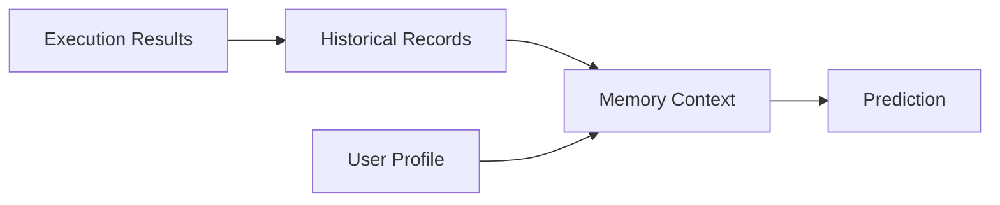

# Memory Architecture

Memory 分为 Realtime、Historical、User Profile、AI Effectiveness 四类。

Realtime 不长期保存；Historical 必须受 retention policy 管理。

当前 `SqliteMemoryStore` 提供持久历史；`personalized_context` 仅在 profile
允许个性化时读取历史，`history_enabled` 单独决定新记录写入。聚合器按 UTC
小时识别有足够样本的 workload 模式，短期预测器可消费该模式。撤销 consent
阻断后续个性化读取，清理与 retention 保留现有契约。尚未有真实效果观测的
长期存储与个性化收益评估；模型模拟结果不能作为已观测收益。
