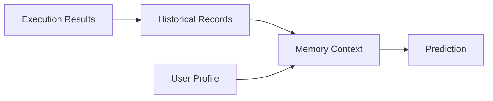

[English](MEMORY_ARCHITECTURE.md) | [Chinese](MEMORY_ARCHITECTURE.zh-CN.md)
# Memory Architecture

Memory has four categories: real-time state, history, user profile, and AI effects. Real-time state is short-lived; history follows a configured retention policy.

`SqliteMemoryStore` persists history. `personalized_context` controls whether retained personal history may be read, while `history_enabled` separately controls new writes. Aggregation groups records by application and UTC hour to identify workload patterns only after enough samples. With consent, registered tasks may retain an `application_id` for application-level aggregation. The predictor sees only records permitted for the same application; it does not infer an application identity from unrelated data. Older JSON history without this field remains readable.

The short-horizon predictor can inform validated policy execution in Model Mode, but model results are not evidence of real pre-allocation gains. Revoking consent blocks later personalized reads; deletion and retention use the existing contracts. Long-term storage and personalization benefits still need actual-effect observations, not simulated measurements.