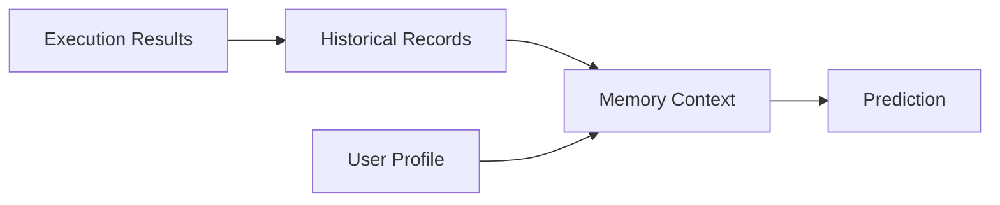

[英文](MEMORY_ARCHITECTURE.md) | [中文](MEMORY_ARCHITECTURE.zh-CN.md)
# 记忆架构

记忆分为实时状态、历史记录、用户画像和 AI 效果四类。实时状态仅短期保留；历史记录遵守配置的数据保留策略。

`SqliteMemoryStore` 持久化历史。`personalized_context` 控制是否可以读取已保留的个人历史，`history_enabled` 则独立控制新记录写入。聚合按应用及协调世界时小时分组，只在样本足够时识别工作负载模式。经用户同意，已注册任务可以保留 `application_id`，用于应用级聚合。预测器只能看到同一应用被允许使用的记录，不会从无关数据推测应用身份。缺少该字段的旧版 JSON 历史仍可读取。

短期预测器可以为模型模式下经校验的策略执行提供输入，但模型结果不能证明真实的预分配收益。撤销同意会阻止后续个人化读取；删除和保留期处理沿用现有契约。长期存储与个人化收益仍需真实效果观测，不能用模拟测量代替。