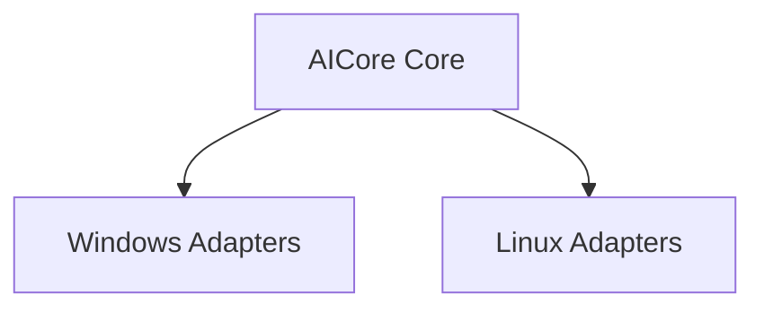

[English](PLATFORM_ARCHITECTURE.md) | [Chinese](PLATFORM_ARCHITECTURE.zh-CN.md)
# Platform Architecture

Initial platforms: Windows and Linux. macOS is outside the current product scope.

Core logic is shared; platform differences belong in the adapter and runtime layers.
