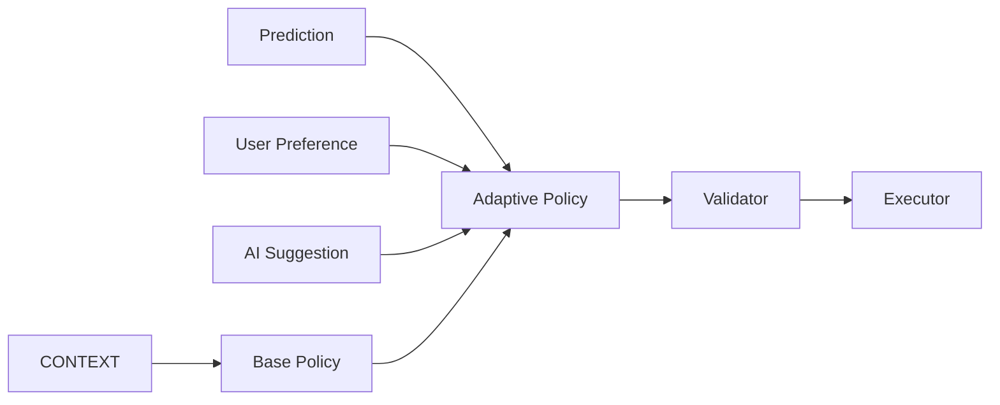

[English](POLICY_SYSTEM.md) | [Chinese](POLICY_SYSTEM.zh-CN.md)
# Policy System

Policy is derived from context, prediction, user preferences, and optional AI suggestions.

Policy itself does not execute system calls.
