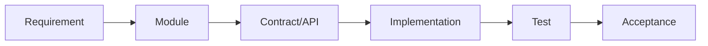

[English](TRACEABILITY.md) | [Chinese](TRACEABILITY.zh-CN.md)
# Requirement Traceability

Every functional or nonfunctional requirement must trace to at least one implementation entry point and one item of test or acceptance evidence.
