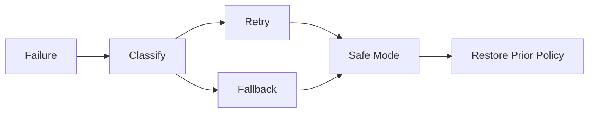

# Failure Recovery

原则：

> AICore 可以失败，但操作系统不能因为 AICore 失败而失败。

每个失败必须记录 cause、stage、resource、retryable、final outcome。

V4 当前实现：TransparentExecutor 的 Observe/Decide/Validate 标记为 Skipped，表示这些阶段由 AdaptiveLoop 完成。Apply 明细保留原执行结果；Verify 失败后回滚成功时 final_status 为 NoOp，回滚失败或没有 prior policy 时为 AllFailed。NoOp 对 SafeMode 中性，不伪装为成功。策略校验被拒绝时，本轮已出队任务进入 Failed。
