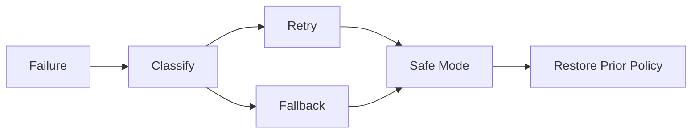

[English](FAILURE_RECOVERY.md) | [Chinese](FAILURE_RECOVERY.zh-CN.md)
# Failure Recovery

Principle:

> AICore may fail, but its failure must not bring down the operating system.

Every failure record must include its cause, stage, resource, retryability, and final outcome.

In the current V4 implementation, `TransparentExecutor` marks Observe, Decide, and Validate as `Skipped` because `AdaptiveLoop` performs those stages. Apply retains the actual execution result. If Verify fails and rollback succeeds, `final_status` is `NoOp`; rollback failure or the absence of a prior policy yields `AllFailed`. `NoOp` is neutral for SafeMode, never a claimed success. A dequeued task whose policy validation fails becomes `Failed`.