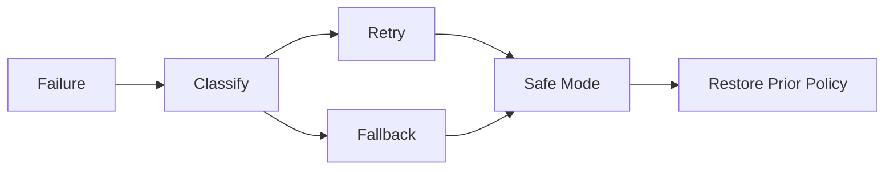

[英文](FAILURE_RECOVERY.md) | [中文](FAILURE_RECOVERY.zh-CN.md)
# 故障恢复

原则：

> AICore 可以失败，但它的失败不能拖垮操作系统。

每条故障记录都必须包含原因、阶段、资源、是否可重试以及最终结果。

在当前 V4 实现中，`TransparentExecutor` 将观察、决策和校验标记为 `Skipped`，因为这些阶段由 `AdaptiveLoop` 完成。应用阶段保留实际执行结果。如果验证失败而回滚成功，`final_status` 为 `NoOp`；回滚失败或没有先前策略时为 `AllFailed`。`NoOp` 对安全模式是中性结果，不能宣称成功。已出队任务的策略校验失败时，该任务进入 `Failed` 状态。