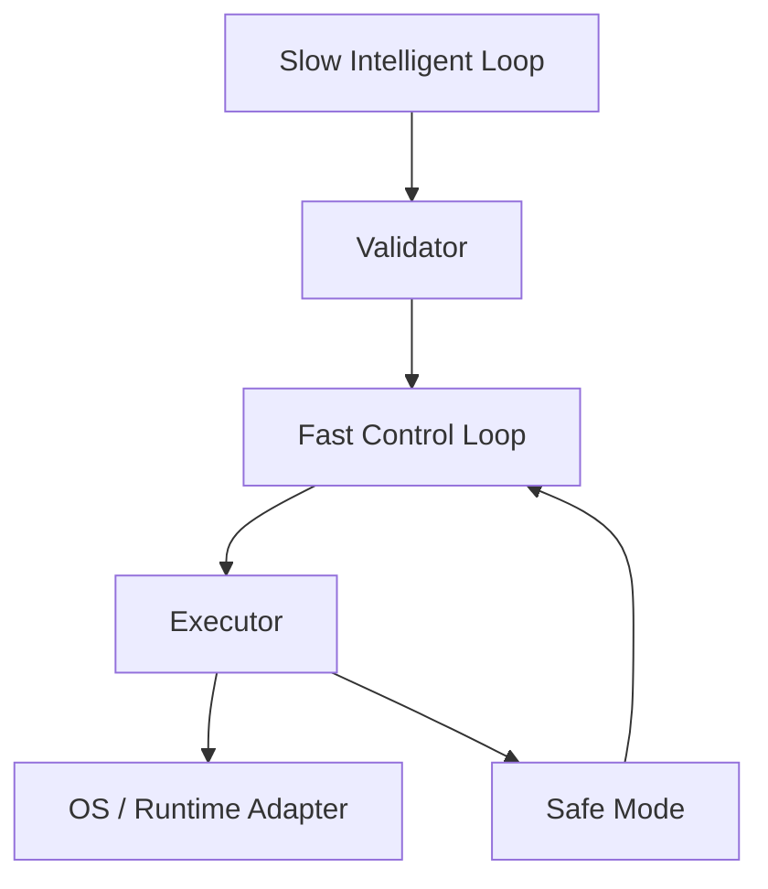

[English](RUNTIME_ARCHITECTURE.md) | [Chinese](RUNTIME_ARCHITECTURE.zh-CN.md)
# Runtime Architecture

- Slow loop: prediction, context understanding, and AI inference.
- Fast loop: state update, validation, execution, and recovery.
- The UI does not participate in the closed control loop.

## Current implementation

In continuous Model Mode, `ModelTickDriver` prepares telemetry, history, prediction, policy validation, and model binding on the slow side. The fast side consumes only prepared, unexpired policies and updates SafeMode after validation and execution. If preparation is pending or expires, it returns neutral NoOp and clears the discarded task's queue state. History writes and retention also run in background work. The model executor and binder prevent this path from reaching platform controllers.

In continuous Platform Mode, `PlatformTickDriver` prepares telemetry, history, prediction, and validation on the slow side. Runtime binding that could change device state occurs only after a SafeMode check on the execution side. A slow mock telemetry provider demonstrates that waiting for preparation does not block the fast side and that expired plans do not reach the binder. Platform binding, execution, event publication, and state-file writes may still take time, so an end-to-end hard deadline is not certified. `--once` still uses the synchronous path.

`AICORE_EXECUTION_MODE=simulated-platform` exercises Platform Mode through `PlatformTickDriver`, including policy execution, readback, rollback, and SafeMode. Its platform adapters are memory-only and use fixtures from real read-only collection. Simulation tests cover delayed preparation, expiry, and application of a fresh policy; they cannot prove native worst-case timing or hardware effects.

`LoopMetrics.last_fast_control_us` and `last_slow_prepare_us` measure loop durations. These timings are not evidence of workload performance or energy savings. NoOp is counted separately and is not a failure.