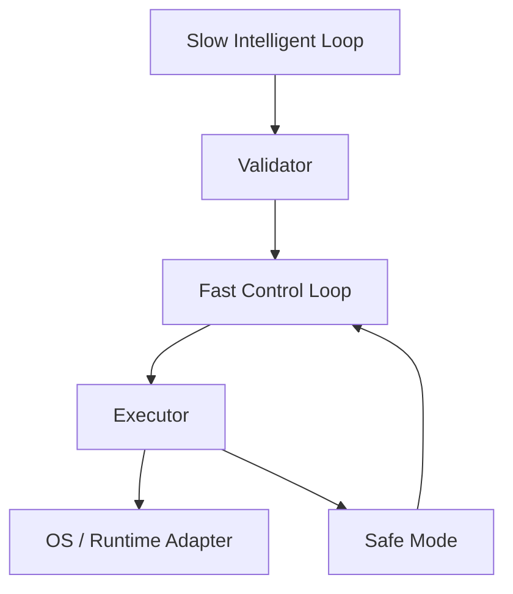

# Runtime Architecture

- Slow loop：预测、上下文理解、AI。
- Fast loop：状态更新、校验、执行、回退。
- UI 不参与控制闭环。

## 实现状态

Model Mode 的持续运行由 `ModelTickDriver` 接入 daemon：有界慢线程完成遥测、
历史读取、预测、策略校验和模型 runtime binding，快侧只消费已准备且未过期的
策略，执行/验证后更新 SafeMode。准备未完成或过期时返回中性 NoOp；丢弃的
准备任务会清理其队列状态。历史写入和 retention 也交给有界后台线程。
模型 executor/binder 检查阻止这条异步路径接触平台控制器。持续运行的
Platform Mode 使用 `PlatformTickDriver`，慢线程准备遥测、历史、预测和已校验
策略；可能写入设备状态的 runtime binding 只在策略新鲜度与 SafeMode 检查后
于执行侧进行。Mock 慢遥测证明等待准备不会阻塞调度，过期计划不会调用
binder。平台 binder、执行、事件发布和状态文件写入仍可能耗时，故**没有**
平台快环硬 deadline 的真机证明。`--once` 仍使用同步路径。

`AICORE_EXECUTION_MODE=simulated-platform` 保留 Platform Mode 的
`PlatformTickDriver`、策略执行、读回、回滚和 SafeMode 路径，但把所有平台
Adapter 换为基于真实只读采集 fixture 的内存实现。模拟测试已覆盖慢 provider
过期与新鲜策略应用；它不能证明真机 binder 的最坏耗时或硬件执行效果。

`LoopMetrics.last_fast_control_us` 和 `last_slow_prepare_us` 是实际测得的环路
耗时，不能当作任务性能或节能收益。NoOp 单独计数，不计入失败次数。
