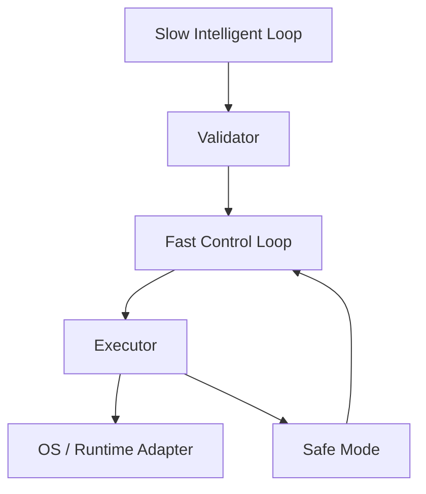

# Runtime Architecture

- Slow loop：预测、上下文理解、AI。
- Fast loop：状态更新、校验、执行、回退。
- UI 不参与控制闭环。

## 实现状态

上述是 destination 目标。当前 daemon 仍在 `AdaptiveLoop::tick` 中同步读取
遥测、历史、预测和执行 runtime binding。`runtime::dual_loop` 已提供不可变
策略交接、过期/取消检查以及不等待慢 provider 的快侧消费组件，mock 测试覆盖
卡住的慢任务；它尚未接入 daemon 的正式调度或 SafeMode。因此目前不能声称
整个控制环满足快侧 deadline，也不能让过期的异步硬件 binding 发生。
