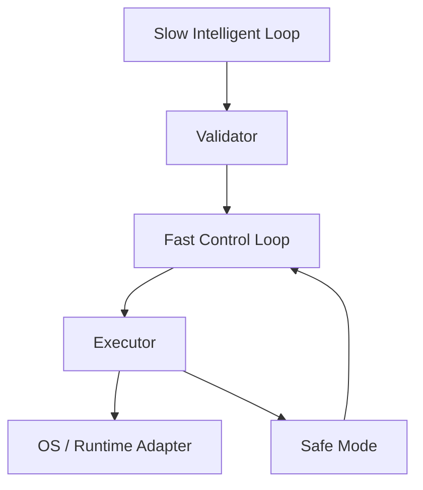

[英文](RUNTIME_ARCHITECTURE.md) | [中文](RUNTIME_ARCHITECTURE.zh-CN.md)
# 运行时架构

- 慢环：预测、上下文理解与 AI 推理。
- 快环：状态更新、校验、执行与恢复。
- 用户界面不参与闭环控制。

## 当前实现

在连续运行的模型模式中，`ModelTickDriver` 在慢侧准备遥测、历史、预测、策略校验和模型绑定。快侧只消费已准备且未过期的策略，并在校验与执行后更新安全模式。准备未完成或已过期时返回中性的无操作结果，并清理被丢弃任务的队列状态。历史写入和保留期处理也在后台执行。模型执行器与绑定器防止此路径触及平台控制器。

在连续运行的平台模式中，`PlatformTickDriver` 在慢侧准备遥测、历史、预测和校验。可能改变设备状态的运行时绑定仅在执行侧通过安全模式检查后发生。缓慢的模拟遥测提供者证明，等待准备不会阻塞快侧，过期计划也不会进入绑定器。平台绑定、执行、事件发布和状态文件写入仍可能耗时，因此未认证端到端硬截止期限。`--once` 仍采用同步路径。

`AICORE_EXECUTION_MODE=simulated-platform` 通过 `PlatformTickDriver` 运行平台模式，包括策略执行、读回、回滚和安全模式。其平台适配器仅写入内存，使用真实只读采集得到的样本。模拟测试覆盖延迟准备、过期以及新鲜策略的应用；它不能证明原生最坏情况耗时或硬件效果。

`LoopMetrics.last_fast_control_us` 与 `last_slow_prepare_us` 测量循环耗时。这些时间数据不代表工作负载性能或节能收益。无操作单独计数，不算作失败。