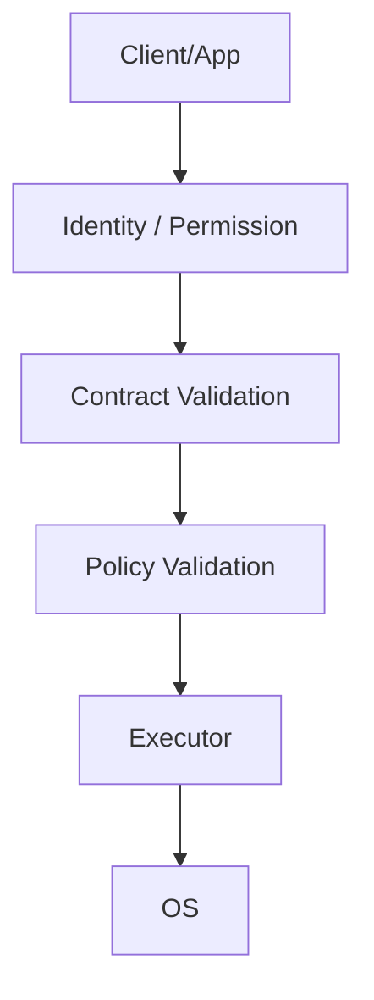

[English](SECURITY_ARCHITECTURE.md) | [Chinese](SECURITY_ARCHITECTURE.zh-CN.md)
# Security Architecture

Security boundaries cover at least IPC, plugins, models, runtime, configuration, and persistent data.
