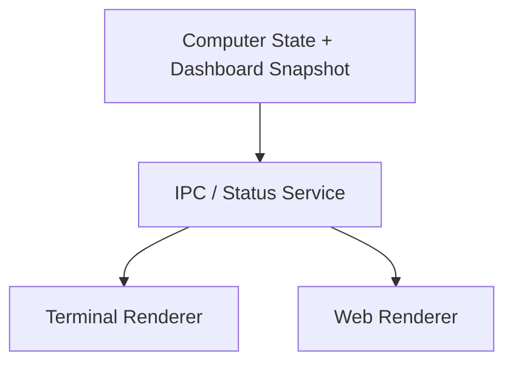

[English](DASHBOARD_ARCHITECTURE.md) | [Chinese](DASHBOARD_ARCHITECTURE.zh-CN.md)
# Dashboard Architecture

Terminal and web views are two renderers of the same data plane.

Neither interface should collect system state independently.
